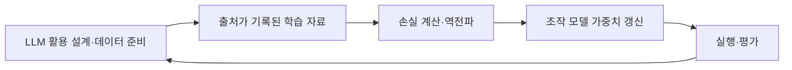
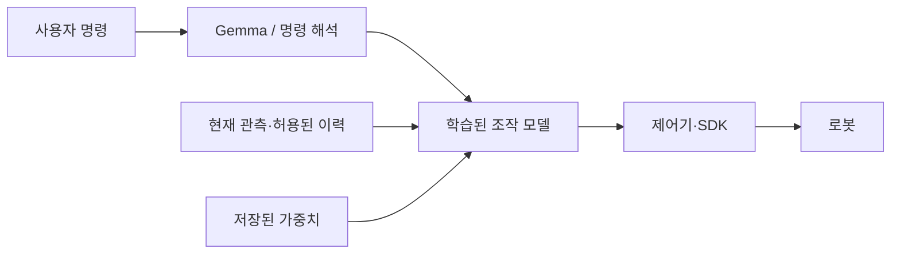

# LLM-Driven Robot Policy Learning

> **로봇에게 명령하는 AI에서, 로봇의 능력을 학습시키는 AI로.**
>
> 연구 질문: LLM이 설계와 데이터 준비에 참여하고, 작은 조작 모델이 가중치 갱신을 통해 행동을 배울 수 있을까?
>
> **Research question:** Can LLM-assisted design and data preparation help a small robot policy acquire behavior through learned weight updates?

[구조와 코드 / Architecture & code](docs/TECHNICAL_GUIDE.md) · [학습 코드 / Training](raccoon_memory/scene_trajectory_training.py) · [논문 초안 / Paper draft](papers/paper-draft.pdf) · [공개 패키지 / Downloads](https://github.com/dreaminglizard/llm-driven-robot-policy-learning/releases/tag/v0.1.0-research)

**처음 보는 분께:** 아래에서 개발·실행 구조를 보고, 로봇 없이 첫 예제를 실행한 다음, 코드와 공개 근거를 확인할 수 있습니다. 라쿤봇은 이 연구 방향을 적용한 사례입니다.

## 로봇보다, 로봇의 능력을 만드는 과정

이 프로젝트가 다루는 핵심은 특정 로봇의 이름이 아니라 **LLM을 활용해 로봇 조작 모델을 설계하고, 학습 자료를 만들고, 학습을 통해 가중치를 수정하고, 실행 결과를 검토하는 개발 과정**입니다. 라쿤봇은 이 과정을 실제로 적용해 본 검증 사례입니다.

제가 도전하려는 방향은 로봇마다 모든 행동을 사람이 일일이 작성하는 대신, AI가 로봇의 능력을 만드는 과정에도 참여하는 것입니다. 여기서 중요한 것은 명령을 함수로 바꾸는 것만이 아니라 **조작 모델의 가중치가 학습으로 바뀐다는 점**입니다. 이 가능성을 더 많은 사람이 코드와 자료로 직접 검토할 수 있도록 공개합니다.

## 두 가지 흐름

### 학습: 데이터가 가중치로



### 실행: 명령이 로봇 동작으로



학습 코드의 실제 연결은 **`loss.backward()` → `optimizer.step()` → 체크포인트 저장**입니다. [가중치가 바뀌는 코드](raccoon_memory/scene_trajectory_training.py)에서 확인할 수 있습니다. Gemma가 임의의 가중치 숫자를 직접 써 넣는다는 뜻은 아닙니다.

위 그림은 전체 개념도입니다. 저장소에는 여러 모델·실험 경로가 있고, [일부 계획 경로](raccoon_memory/inference.py)는 학습 정책에 제한된 기호 탐색을 더합니다. 모델별 호출 함수와 경계는 [기술 안내](docs/TECHNICAL_GUIDE.md)에 구분했습니다.

LLM의 명령 해석과 조작 모델의 학습·추론은 서로 다른 단계입니다. 실행할 때마다 LLM이 직접 모든 관절 명령을 생성한다는 뜻은 아닙니다.

## 로봇 없이 첫 실행 / First runnable check

저장소를 내려받은 폴더에서 Python 3.11 이상으로 실행합니다. SDK나 모델 다운로드는 필요 없습니다.

```sh
python -m examples.offline_world_smoke
```

```text
PASS: symbolic move, restoration, 80-value encoding, invalid-state rejection
1/2/3/4 -> -/21/3/4 -> 1/2/3/4
Not tested: learned weights, LLM inference, physics, or hardware.
```

각 `/`는 자리를 나누며, `21`은 원통 2 위에 원통 1이 놓인 상태입니다. [이 예제](examples/offline_world_smoke.py)는 이동·복원과 상태 표현을 확인합니다. **학습 모델 추론이나 물리 시뮬레이션은 아닙니다.** 클라우드 Python 3.12.14에서 위 출력을 확인했습니다.

For English readers: this dependency-free example checks the symbolic task representation, not learned-policy quality. See the [bilingual technical guide](docs/TECHNICAL_GUIDE.md) for model families, actual weight-update functions and verification scope.

## 주장과 확인 경로 / Claims and evidence

| 확인할 질문 | 공개된 진입점 | 구분해서 읽을 점 |
|---|---|---|
| 실제 가중치를 학습하는가? | [학습 함수](raccoon_memory/scene_trajectory_training.py) · [선정 모델](models/) | 학습 코드·저장 가중치의 존재와 성능·일반화 입증은 별개 |
| 모델은 무엇을 출력하는가? | [ScenePolicy](raccoon_memory/scene_policy.py) · [모델 정의](raccoon_memory/neural.py) | 모델 계열마다 입력·출력·체크포인트 형식이 다름 |
| 선정 근거는 어디에 있는가? | [선정 정책 근거 ZIP](https://github.com/dreaminglizard/llm-driven-robot-policy-learning/releases/download/v0.1.0-research/LLM_selected_policy_evidence_20261113.zip) | 저장된 근거 자료이며, 이 소개 개선에서 새 성능 실험을 하지는 않음 |
| 직접 시연 자료를 볼 수 있는가? | [직접 시연 자료 ZIP](https://github.com/dreaminglizard/llm-driven-robot-policy-learning/releases/download/v0.1.0-research/LLM_direct_demonstrations_1000_20261113.zip) | 학습·개발 자료의 공개를 독립 평가 결과로 읽으면 안 됨 |
| 어디까지 직접 확인했는가? | [실행 예제와 검증 범위](docs/TECHNICAL_GUIDE.md) | 위 예제만 실행 확인. 전체 재학습·실물 재현은 별도 |

**시연 영상은 이 페이지에 제공하지 않습니다.** 영상이 있는 것처럼 표시하거나, 저장 관측의 정확도를 실물 성공률로 바꾸어 제시하지 않습니다. 코드로 평가할 때는 데이터 출처·평가 분리·종료 경계를 함께 확인해 주세요.

## 현재 확인된 범위

현재 실증 대상은 제한된 작업공간의 소형 로봇팔입니다. 개발 평가와 실제 시연은 다른 증거로 구분합니다. 여러 로봇·환경에 대한 일반화나 기존 연구 대비 최초성을 입증한 결과로 주장하지 않습니다. 논문은 연구 초안이며, 공개 코드·가중치·평가 자료로 방법과 한계를 함께 확인할 수 있게 정리하고 있습니다.

## 공개 자료

- [소스·선정 가중치 패키지 다운로드](https://github.com/dreaminglizard/llm-driven-robot-policy-learning/releases/tag/v0.1.0-research): 2026년 11월 13일 오전 스냅샷, 8,751개 파일, ZIP 42,941,082바이트. 소스, 학습·평가 스크립트, 테스트, 설정, 소형 자료, 선정 조작·기억 가중치와 파일별 SHA-256 목록을 포함합니다.
- [논문 초안 PDF](papers/paper-draft.pdf) · [논문 및 근거 자료 ZIP](papers/paper-materials.zip)
- 코드 바로 보기: [조작 모델·기억 모듈](raccoon_memory/) · [제어 모듈](raccoon_control/) · [설정](configs/) · [선정 모델 파일](models/)

**실행 준비에는 릴리스의 패키지 ZIP을 사용하세요.** 저장소에서 바로 볼 수 있는 코드는 주요 모듈 발췌이며, ZIP은 원래의 스크립트·테스트·가중치 경로를 보존합니다. 설치와 장치 설정은 패키지의 안내 문서를 참고하세요. 이번 공개 과정에서 새 학습이나 실물 로봇 실행은 하지 않았습니다.

ZIP SHA-256: `508826d83762dc602d783bee1c0c27aed9dd919d024a827b233a0b4f8abd2d3e`

현재 패키지는 **모든 실험 이력과 대용량 데이터를 포함한 완전 재학습 패키지가 아닙니다.** 원본의 수십 GB 연구 산출물·중간 체크포인트·대규모 시연 및 평가 데이터는 아직 게시하지 않았습니다. Gemma·Whisper 본체와 SDK 바이너리는 포함하지 않으며, 각 공식 배포처와 라이선스에 따라 별도로 준비해야 합니다. 인증정보, 개인 실행 로그, 비공개 대화 링크는 제외했습니다.

## 공개하는 이유

2026년 11월 13일 IRC에서 발표와 시연은 성공했지만, 결과는 16팀 중 16등이었습니다. 솔직히 많이 우울했고, 제 아이디어와 판단을 믿기 어려웠습니다. 그래도 제가 보여주고 싶었던 핵심은 특정 로봇 한 대가 아니라, 앞으로 로봇의 능력을 만드는 방식이었습니다. 그래서 결과를 숨기기보다 코드와 과정을 공개하고, 이 방향이 어디까지 가능한지 구체적인 피드백을 받고 싶습니다.

## 이용 안내

실물 로봇 실행 전 장치·SDK·관절 제한과 정지 방법을 확인해야 합니다. 공개 자체가 재배포 라이선스 부여를 뜻하지는 않으며, 별도 라이선스를 임의로 지정하지 않았습니다. 외부 모델과 의존성은 각각의 라이선스를 따릅니다.
