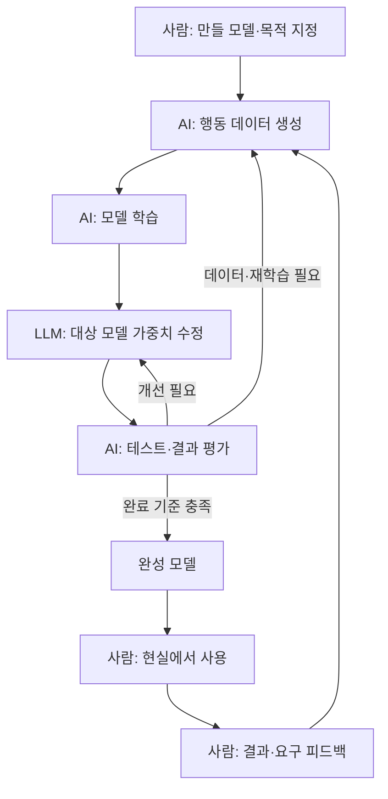
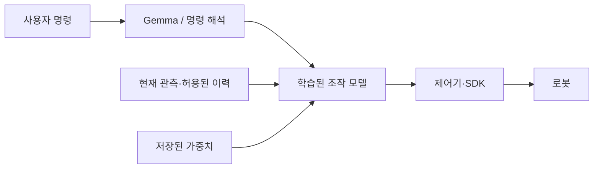

# LLM-Driven Robot Policy Learning

> **AI를 사용하는 것에서, AI와 함께 더 많은 모델을 만드는 것으로.**
>
> 최종 비전은 로봇 한 대가 아닙니다. 사람이 만들 모델을 정하면 AI가 행동 데이터 생성·학습·LLM 가중치 수정과 테스트를 반복하고, 사람은 완성 모델을 현실에서 사용하며 피드백하는 구조가 목표입니다. 이 고리가 확장되면 더 많은 목적별 모델을 만들 수 있지 않을까?
>
> **Vision:** People specify and use models; AI leads data generation, training, weight modification and testing, then improves them from human feedback.
>
> **라쿤봇은 이 방향을 탐색하는 첫 사례입니다.** 현재 공개한 것은 로봇 조작 모델의 코드·선정 가중치·연구 자료이며, 모든 종류의 모델에 적용되는 생산 체계는 장기 비전입니다.

[구조와 코드 / Architecture & code](docs/TECHNICAL_GUIDE.md) · [학습 코드 / Training](raccoon_memory/scene_trajectory_training.py) · [개정 초안 v0.7 / Revised draft](papers/paper-draft-v0.7.pdf) · [공개 패키지 / Downloads](https://github.com/dreaminglizard/llm-driven-robot-policy-learning/releases/tag/v0.1.0-research)

**읽는 순서:** 문제의식·기사 영감 → AI 주도 전체 고리 → 현재 구현과 비전의 차이 → 핵심 자료·첫 실행 → 후속 비교 검증. [기술 안내](docs/TECHNICAL_GUIDE.md)는 코드 진입점, [개정 초안 v0.7](papers/paper-draft-v0.7.pdf)은 연구 설명을 담습니다.

## 목표하는 전체 고리 / Target loop

**사람은 만들 모델과 목적을 정하고, 완성된 모델을 현실에서 사용한 뒤 피드백합니다. 중간 제작 과정은 AI가 주도하는 것이 목표입니다.**



이 그림은 **최종 비전**입니다. AI가 데이터 생성부터 학습·가중치 수정·테스트 반복을 주도하고, 사람의 실제 사용 피드백을 다음 개선으로 연결하는 구조입니다. 여기서 수정 대상은 만들고 있는 모델의 가중치이며, 로봇 사례에서는 조작 모델입니다. 목표는 사람이 중간 단계마다 코드를 고치고 학습을 다시 지시하는 개입을 최소화하는 것입니다. 사람의 안전 승인·중단 권한을 없앤다는 뜻은 아닙니다.

**확장 방향:** 라쿤봇은 첫 사례입니다. 같은 제작·개선 고리를 서로 다른 목적과 다른 로봇에 적용해, 각각에 맞는 모델을 더 많이 생산하는 것이 목표입니다. 동일 가중치를 모든 로봇에 그대로 옮기는 것이 아니라, 대상의 입력·출력·데이터·시험 조건에 맞춘 모델 제작을 뜻합니다. 이후 다른 종류의 모델까지 확장할 수 있는지는 별도로 검증할 가설입니다.

**Expansion goal:** Minimize manual intervention inside the AI-led development loop while retaining human safety oversight. Extend the process to task-specific models for different robots, and eventually investigate other model types. This is a model-production goal, not a claim of universal weight transfer or already demonstrated scale.

**현재 확인된 구현과의 차이:** 공개 코드에는 학습 손실·역전파·옵티마이저에 의한 가중치 갱신이 있습니다. LLM이 가중치 또는 변화량을 직접 생성·적용하는 단계와 위 전체 고리의 자율 작동은 아직 공개 자료로 입증되지 않았습니다. 완성 판정 기준, 사람의 승인·개입 경계, 실제 사용 피드백의 검증 방식도 후속 연구에서 정해야 합니다.

**English:** People specify the model and its purpose, then use the finished model in the real world and provide feedback. The intended AI-led middle loop is behavior-data generation → training → LLM modification of the target model's weights → testing and repeated improvement. Real-use feedback returns to that loop. This is the target architecture, not a claim that the published optimizer-based code already implements direct LLM weight editing or the autonomous end-to-end cycle.

### English overview

The long-term aim is **AI-assisted model creation across domains**, not one robot. The hypothesis is that an AI-led creation-and-improvement loop, bounded by human goal-setting and real-use feedback, could produce more task-specific models. RaccoonBot is the first case study presented here.

**What exists today:** published robot-policy code, selected trained weights and research artifacts. The training code computes gradients and updates policy parameters through an optimizer. **What remains a hypothesis:** higher model-production throughput, broad applicability across model types and autonomous end-to-end model creation. Those outcomes have not been established by this repository.

LLM assistance and optimizer-driven weight updates are distinct. At runtime in the robot case, Gemma interprets instructions; learned policies and the controller/SDK handle downstream behavior.

Start with the [technical guide](docs/TECHNICAL_GUIDE.md) or the dependency-free [symbolic smoke check](examples/offline_world_smoke.py). The public source contains several model families, including a planning path with optional symbolic search. Recorded prediction metrics, simulated behavior and physical demonstration are different evidence. This is a research snapshot, not a claim of general-purpose robotics or complete independent reproduction.

**Feedback / 피드백:** [재현 결과·설치 문제 / Reproduction report](https://github.com/dreaminglizard/llm-driven-robot-policy-learning/issues/new?template=reproduction.md) · [방법·근거 검토 / Technical review](https://github.com/dreaminglizard/llm-driven-robot-policy-learning/issues/new?template=technical_review.md). 한국어와 영어 모두 환영합니다. 코드 위치와 실제 확인한 결과를 함께 알려 주세요.

<details>
<summary>연구 배경과 아이디어의 출발점 / Research motivation</summary>

## 첫 사례는 로봇, 목표는 모델을 만드는 과정

이 프로젝트의 중심은 **AI가 모델을 만드는 과정에도 참여하는 구조**입니다. 모델을 한 번 호출하는 데서 끝나지 않고, 데이터를 준비하고 학습을 설계하며 결과를 평가해 가중치를 개선하는 반복 과정으로 역할을 넓히려는 것입니다.

라쿤봇에서는 이 방향을 작은 조작 모델의 개발·학습에 적용했습니다. 여기서 중요한 것은 명령을 함수로 바꾸는 것만이 아니라 **조작 모델의 가중치가 학습으로 바뀐다는 점**입니다. 공개 코드는 그 구체적인 출발점입니다.

이 구조가 다른 모델 제작에도 확장된다면 더 많은 목적별 모델을 만들 수 있다는 것이 장기 가설입니다. 이를 입증하려면 모델 하나의 성능뿐 아니라, 서로 다른 과제에서 필요한 사람의 작업 시간·학습 비용·성공적으로 제작한 모델 수를 비교해야 합니다. 현재 자료가 그 확장성이나 생산성 향상을 이미 증명한다는 뜻은 아닙니다.

### 아이디어의 출발점

제가 이 아이디어를 떠올린 계기는 **LLM이 LLM의 가중치를 개선한 연구를 소개한 기사**였습니다. 거기서 “LLM이 피지컬 AI, 즉 로봇 모델의 가중치에도 개입해 성능을 개선할 수 있지 않을까?”라는 질문으로 이어졌습니다. 여기서는 출발점이 된 특정 논문을 식별하지 않았으므로 제목이나 성과를 추정해 인용하지 않습니다.

이 동기는 현재 구현의 증거와 구분합니다. 공개 코드에서 확인되는 가중치 갱신은 학습 손실·역전파·옵티마이저를 통한 갱신입니다. LLM이 코드나 학습 설정을 제안하는 것, 그 설정으로 학습기가 가중치를 바꾸는 것, LLM이 가중치나 가중치 변화량 자체를 생성하는 것은 서로 다른 방식입니다. **현재 자료가 마지막 방식을 구현·검증했다고 주장하지 않습니다.**

**Origin:** The idea began with research described as an LLM improving another LLM's weights, leading to the question of whether similar intervention could improve physical-AI robot models. The specific paper is not identified here. The published optimizer-based updates are distinct from an LLM directly generating weights or weight deltas.


</details>

## 현재 코드의 개발·실행 흐름 / Published-code paths

### 학습: 데이터가 가중치로


### 실행: 명령이 로봇 동작으로



학습 코드의 실제 연결은 **`loss.backward()` → `optimizer.step()` → 체크포인트 저장**입니다. [가중치가 바뀌는 코드](raccoon_memory/scene_trajectory_training.py)에서 확인할 수 있습니다. Gemma가 임의의 가중치 숫자를 직접 써 넣는다는 뜻은 아닙니다.

위 그림은 전체 개념도입니다. 저장소에는 여러 모델·실험 경로가 있고, [일부 계획 경로](raccoon_memory/inference.py)는 학습 정책에 제한된 기호 탐색을 더합니다. 모델별 호출 함수와 경계는 [기술 안내](docs/TECHNICAL_GUIDE.md)에 구분했습니다.

LLM의 명령 해석과 조작 모델의 학습·추론은 서로 다른 단계입니다. 실행할 때마다 LLM이 직접 모든 관절 명령을 생성한다는 뜻은 아닙니다.

## 로봇 없이 첫 실행 / First runnable check

Python 3.11 이상이 필요합니다. Git으로 저장소를 받거나 GitHub의 **Code → Download ZIP**으로 내려받아 압축을 풉니다. Git을 사용하는 경우:

```sh
git clone https://github.com/dreaminglizard/llm-driven-robot-policy-learning.git
cd llm-driven-robot-policy-learning
```

저장소 폴더에서 아래 명령을 실행합니다. SDK·모델 다운로드나 추가 패키지 설치는 필요 없습니다.

```sh
python -m examples.offline_world_smoke
```

```text
PASS: symbolic move, restoration, 80-value encoding, invalid-state rejection
1/2/3/4 -> -/21/3/4 -> 1/2/3/4
Not tested: learned weights, LLM inference, physics, or hardware.
```

각 `/`는 자리를 나누며, `21`은 원통 2 위에 원통 1이 놓인 상태입니다. [이 예제](examples/offline_world_smoke.py)는 이동·복원과 상태 표현을 확인합니다. **학습 모델 추론이나 물리 시뮬레이션은 아닙니다.** 클라우드 Python 3.12.14에서 위 출력을 확인했습니다.

For English readers: this dependency-free example checks the symbolic task representation, not learned-policy quality. See the [bilingual technical guide](docs/TECHNICAL_GUIDE.md) for model families, actual weight-update functions and verification scope.

## 주장과 확인 경로 / Claims and evidence

| 확인할 질문 | 공개된 진입점 | 구분해서 읽을 점 |
|---|---|---|
| 실제 가중치를 학습하는가? | [학습 함수](raccoon_memory/scene_trajectory_training.py) · [선정 모델](models/) | 학습 코드·저장 가중치의 존재와 성능·일반화 입증은 별개 |
| 모델은 무엇을 출력하는가? | [ScenePolicy](raccoon_memory/scene_policy.py) · [모델 정의](raccoon_memory/neural.py) | 모델 계열마다 입력·출력·체크포인트 형식이 다름 |
| 선정 근거는 어디에 있는가? | [선정 정책 근거 ZIP](https://github.com/dreaminglizard/llm-driven-robot-policy-learning/releases/download/v0.1.0-research/LLM_selected_policy_evidence_20261113.zip) | 저장된 근거 자료이며, 이 소개 개선에서 새 성능 실험을 하지는 않음 |
| 직접 시연 자료를 볼 수 있는가? | [직접 시연 자료 ZIP](https://github.com/dreaminglizard/llm-driven-robot-policy-learning/releases/download/v0.1.0-research/LLM_direct_demonstrations_1000_20261113.zip) | 학습·개발 자료의 공개를 독립 평가 결과로 읽으면 안 됨 |
| 어디까지 직접 확인했는가? | [실행 예제와 검증 범위](docs/TECHNICAL_GUIDE.md) | 위 예제만 실행 확인. 전체 재학습·실물 재현은 별도 |

현재 공개 경로는 코드·가중치·기록 자료입니다. 시연 영상은 아직 제공하지 않습니다. 기록 기반 예측 정확도와 실물 성공률은 구분하며, 평가 시 데이터 출처·평가 분리·종료 경계를 함께 확인해야 합니다.

## 현재 확인된 범위

현재 실증 대상은 제한된 작업공간의 소형 로봇팔입니다. 개발 평가와 실제 시연은 다른 증거로 구분합니다. 여러 로봇·환경에 대한 일반화나 기존 연구 대비 최초성을 입증한 결과로 주장하지 않습니다. 논문은 연구 초안이며, 공개 코드·가중치·평가 자료로 방법과 한계를 함께 확인할 수 있게 정리하고 있습니다.

## 후속 연구 / Next research

다음 단계의 질문은 **“로봇 하나가 동작하는가?”를 넘어 “AI의 학습·개선 참여가 검증된 모델을 만드는 데 실제로 도움이 되는가?”**입니다. 아래는 앞으로 검증할 계획이며, 완료된 실험 결과가 아닙니다.

| 우선순위 | 검증 질문 | 비교·기록할 것 | 완료 판단 |
|---|---|---|---|
| 1. 기준 실행 고정 | 다른 환경에서도 선정 모델을 불러 같은 검사를 수행할 수 있는가? | 코드 버전, 선정 가중치 해시, 의존성, 입력·출력, 실행 명령 | 별도 환경의 실행 기록과 실패 조건 공개. 현재 기호 예제 PASS와 학습 모델 재현을 구분 |
| 2. 가중치 갱신 효과 | 학습 전후 행동 차이가 실제로 있는가? | 동일 평가 입력에서 학습 전/후 및 적절한 기준 모델 비교. 탐색·규칙 보조 사용 여부 분리 | 사전에 고정한 평가 조건에서 개선과 실패를 함께 제시 |
| 3. 독립 평가 | 개발 자료 밖에서도 결과가 유지되는가? | 원본 출처 단위 중복 검사, 학습·선정·최종 평가 분리, 연속 동작의 기억·종료 경계 | 최종 평가 자료를 모델 선택에 사용하지 않은 결과 기록 |
| 4. 제작 생산성 | AI 참여가 더 많은 유효 모델 제작으로 이어지는가? | 같은 과제·예산에서 AI 참여 범위를 달리한 비교, 사람 작업 시간, 학습 자원, 실패·재작업, 기준을 충족한 모델 수 | 품질을 희생한 단순 생성 수가 아닌 비용·시간 대비 유효 모델 수 비교 |
| 5. 다른 과제로 확장 | 첫 사례 밖에서도 같은 과정이 유효한가? | 새 과제의 데이터·평가 기준, 재사용 부분과 사람이 다시 설계한 부분 | 과제별 결과를 분리해 보고. 한 사례를 모든 모델의 가능성으로 일반화하지 않음 |

후속 비교에서는 **① 사람이 정한 학습 설정, ② LLM이 제안한 코드·설정에 따른 옵티마이저 학습, ③ 모델이 직접 생성한 가중치·변화량**을 구분합니다. ③은 별도로 설계·검증해야 할 연구 후보이며, 현재 구현된 기능이나 우수한 방식으로 전제하지 않습니다.

실행은 기존 코드와 저장 결과를 먼저 재사용하는 방식으로 진행합니다. 실물 시험은 별도의 안전 준비와 승인 아래 수행하며, 이 연구 계획 추가 자체로 새 학습이나 모터 작동을 시작한 것은 아닙니다.

**English:** The next study should test whether AI participation improves the production of *validated* models. Priorities are a reproducible selected-model baseline, controlled before/after weight-update comparisons, source-separated evaluation, model-production cost and human effort, then transfer to another task. These are planned tests, not completed findings.

### 핵심 자료 중심의 정리

처음 읽는 경로는 **연구 질문 → 기술 안내 → 선정 코드·가중치 → 필요한 평가 근거 → 재현 방법**으로 유지합니다. 전체 실험 이력을 무조건 추가 게시하기보다, 해당 검증에 필요한 자료를 선별합니다.

기존 공개 릴리스는 연구 시점의 기록으로 보존합니다. 비교 후보·중간 결과·전체 산출물 목록은 핵심 재현 자료와 구분할 보관 후보입니다. 아직 파일을 삭제하거나 공개 범위를 줄이지 않았으며, 로컬 원본의 보관·복구 가능성을 확인하지 않은 상태에서 정리 완료로 간주하지 않습니다.

## 공개 자료

- [소스·선정 가중치 패키지 다운로드](https://github.com/dreaminglizard/llm-driven-robot-policy-learning/releases/tag/v0.1.0-research): 2026년 11월 13일 오전 스냅샷, 8,751개 파일, ZIP 42,941,082바이트. 소스, 학습·평가 스크립트, 테스트, 설정, 소형 자료, 선정 조작·기억 가중치와 파일별 SHA-256 목록을 포함합니다.
- [개정 초안 v0.7 PDF](papers/paper-draft-v0.7.pdf): 22쪽. 전체 제작·개선 고리, 사람의 현실 사용·피드백, 현재 증거와 후속 비교를 정리한 연구 초안입니다. 새 실험 결과를 추가한 판본은 아닙니다.
- 보존 자료: [이전 공개 초안 PDF](papers/paper-draft.pdf) · [이전 논문 및 근거 자료 ZIP](papers/paper-materials.zip). 이 ZIP은 v0.7 개정 패키지가 아닙니다.
- v0.7 PDF SHA-256: `69947691d5be26007a6fa799ecacc36487761fd2bff63744ae08a28db36d1197`.
- 코드 바로 보기: [조작 모델·기억 모듈](raccoon_memory/) · [제어 모듈](raccoon_control/) · [설정](configs/) · [선정 모델 파일](models/)

**기호 예제는 현재 저장소만으로 실행합니다. 전체 연구 스크립트의 실행 준비에는 릴리스의 패키지 ZIP을 참고하세요.** 저장소에서 바로 볼 수 있는 코드는 주요 모듈 발췌이며, ZIP은 원래의 스크립트·테스트·가중치 경로를 보존합니다. 설치와 장치 설정은 패키지의 안내 문서를 참고하세요. 이번 공개 과정에서 새 학습이나 실물 로봇 실행은 하지 않았습니다.

ZIP SHA-256: `508826d83762dc602d783bee1c0c27aed9dd919d024a827b233a0b4f8abd2d3e`

현재 패키지는 **모든 실험 이력과 대용량 데이터를 포함한 완전 재학습 패키지가 아닙니다.** 선정 근거와 직접 시연 자료 일부는 위 링크로 공개되어 있습니다. 원본의 수십 GB 연구 산출물 전체와 모든 중간 체크포인트·시연·평가 데이터가 게시된 것은 아닙니다. 추가 공개는 전체 이력 복제보다 재현과 검증에 필요한 핵심 자료 선별을 우선합니다. Gemma·Whisper 본체와 SDK 바이너리는 포함하지 않으며, 각 공식 배포처와 라이선스에 따라 별도로 준비해야 합니다. 인증정보, 개인 실행 로그, 비공개 대화 링크는 제외했습니다.

### 자료를 고르는 기준 / What to download

| 목적 | 우선 자료 | 용도 |
|---|---|---|
| 개념과 코드 이해 | [기술 안내](docs/TECHNICAL_GUIDE.md), 현재 저장소 | 모델 계열·입출력·가중치 갱신 위치 확인 |
| 가장 작은 실행 확인 | [기호 예제](examples/offline_world_smoke.py) | 학습·장치 없이 작업 표현만 검사 |
| 선정 모델 조사 | [선정 조작 가중치](models/조작_학생_선정_20261030.pt), [기억 가중치](models/기억_GRU128.pt), 선정 근거 ZIP | 각 체크포인트에 맞는 로더·설정·근거를 함께 확인. 파일 이름만으로 모든 실행 경로와의 호환성을 보장하지 않음 |
| 연구 스냅샷 재현 준비 | 소스·선정 가중치 패키지 | 스크립트·테스트·원래 경로 확인. 완전한 재학습 패키지는 아님 |
| 비교·개발 이력 조사 | 다른 후보 가중치, 직접 시연 자료, 기존 릴리스 | 선정 모델과 비교 후보를 구분. 독립 최종 평가 자료로 자동 간주하지 않음 |

모든 파일과 릴리스는 유지했습니다. 위 표는 읽는 순서를 정리한 것이며, 삭제·비공개 전환이나 백업 완료를 의미하지 않습니다.

## 공개하는 이유

2026년 11월 13일 IRC에서 발표와 시연은 성공했지만, 결과는 16팀 중 16등이었습니다. 솔직히 많이 우울했고, 제 아이디어와 판단을 믿기 어려웠습니다. 그래도 제가 보여주고 싶었던 핵심은 특정 로봇 한 대가 아니라, 앞으로 로봇의 능력을 만드는 방식이었습니다. 그래서 결과를 숨기기보다 코드와 과정을 공개하고, 이 방향이 어디까지 가능한지 구체적인 피드백을 받고 싶습니다.

## 이용 안내

실물 로봇 실행 전 장치·SDK·관절 제한과 정지 방법을 확인해야 합니다. 공개 자체가 재배포 라이선스 부여를 뜻하지는 않으며, 별도 라이선스를 임의로 지정하지 않았습니다. 외부 모델과 의존성은 각각의 라이선스를 따릅니다.
