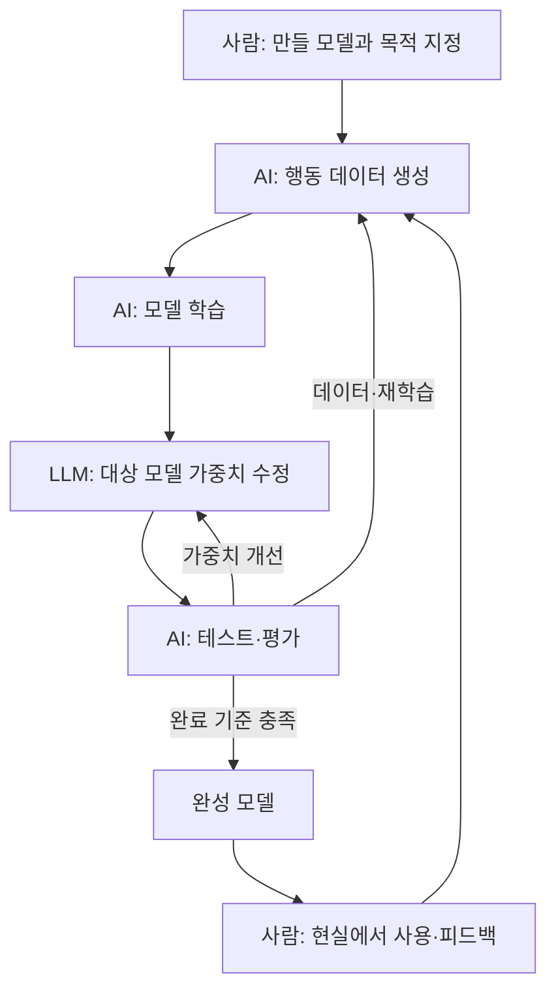

# LLM-Driven Robot Policy Learning

**사람이 원하는 모델을 정하면, AI가 만들고 개선할 수 있을까?**

이 연구의 목표는 로봇 한 대가 아니라 **모델을 만드는 과정**입니다. 사람이 목적을 정하고 완성된 모델을 현실에서 사용하면, AI가 중간의 데이터 생성·학습·가중치 개선을 맡고 사용자의 피드백을 다음 개선에 연결하는 구조를 탐구합니다. 라쿤봇은 그 첫 사례입니다.

[논문 · 한국어/English v0.8.1](https://doi.org/10.5281/zenodo.24212741) · [구현과 첫 실행](docs/TECHNICAL_GUIDE.md) · [선정 모델](https://huggingface.co/DreamingLizard/llm-driven-robot-policy-learning) · [연구 패키지](PUBLIC_PACKAGE_README.md)

## 연구 질문

출발점은 LLM이 LLM의 가중치를 개선한 연구를 소개한 기사였습니다. 여기서 **“LLM이 피지컬 AI 로봇 모델의 가중치도 수정해 개선할 수 있을까?”**라는 질문으로 이어졌습니다. 계기가 된 기사와 원 논문은 여기서 특정하지 않습니다.

목표하는 과정은 다음과 같습니다.

**위 그림은 목표 구조입니다.** 중간 단계마다 사람이 코드를 고치거나 학습을 다시 지시하는 일을 줄이되, 안전 승인과 중단 권한은 유지합니다. 서로 다른 목적·로봇에 맞는 모델을 더 많이 만드는 것이 확장 방향이며, 동일한 가중치를 모든 로봇에 그대로 적용한다는 뜻은 아닙니다.

## 지금 공개한 것

| 구분 | 현재 범위 |
|---|---|
| 구현 | 로봇 조작·기억 모델, 학습 코드, 선정 가중치와 기록 자료 |
| 가중치 갱신 | 손실 계산 → 역전파 → 옵티마이저 갱신 → 체크포인트 저장 |
| 실행 | Gemma의 명령 해석 → 조작 모델 → 제어기·SDK. 경로에 따라 제한된 기호 탐색이 포함됨 |
| 확인된 검사 | 기호 상태 검사, 선정 모델의 엄격한 로드와 합성 입력 CPU 검사. [조건과 범위](docs/TECHNICAL_GUIDE.md) |
| 후속 검증 | LLM의 직접 가중치·변화량 생성, 전체 고리의 자율 작동, 다른 과제에서의 생산성·일반화 |

LLM의 코드·설정 제안, 옵티마이저 학습, LLM의 직접 가중치 수정은 서로 다른 방식입니다. 현재 공개 구현은 두 번째 방식의 가중치 갱신을 보여줍니다. 저장된 예측 지표나 한 번의 시연을 실물 성공률로 바꾸어 주장하지 않습니다.

## 어디서 시작하나요?

- **구조와 모델 호출을 보고 싶다면:** [기술 안내](docs/TECHNICAL_GUIDE.md).
- **직접 실행하려면:** 같은 안내의 기호 검사 또는 선정 모델 로더. 둘 다 로봇 없이 확인하는 경로입니다.
- **연구 설명을 읽으려면:** [최신 한영 논문과 판본 이력](papers/PUBLISHED_VERSION.md).
- **원래 스크립트·근거 자료가 필요하다면:** [고정 릴리스의 구성과 제약](PUBLIC_PACKAGE_README.md).

시연 영상은 현재 제공하지 않습니다. 전체 재학습과 실물 재현이 가능한 완성 패키지로 소개하지 않습니다.

## 다음 연구에서 비교할 것

핵심 질문은 **AI 참여가 같은 시간과 자원으로 더 많은 유효 모델을 만드는 데 도움이 되는가**입니다.

1. 코드·가중치·입출력 계약을 고정한 재현 기준.
2. 사람의 설정, LLM의 코드·설정 제안, 직접 가중치 수정의 구분 비교.
3. 원본 출처 단위로 분리한 학습·선정·최종 평가와 연속 동작의 기억·종료 검사.
4. 품질을 충족한 모델 수, 사람 작업 시간, 학습 비용과 재작업량.
5. 실제 사용 피드백의 반영 효과와 다른 과제·로봇으로의 확장.

이 항목들은 완료된 성과가 아니라 검증 계획입니다. [재현 결과](https://github.com/dreaminglizard/llm-driven-robot-policy-learning/issues/new?template=reproduction.md)와 [방법·근거 검토](https://github.com/dreaminglizard/llm-driven-robot-policy-learning/issues/new?template=technical_review.md)는 한국어·영어 모두 환영합니다.

## English summary

Can AI help produce more useful models, rather than only operate one robot? The intended loop is human specification → AI-generated behavior data → training → LLM modification of the target model's weights and repeated testing → real-world use and human feedback. RaccoonBot is the first case study.

The published code demonstrates optimizer-based policy updates, not direct LLM weight editing or the full autonomous loop. Current entry checks cover symbolic state handling and selected-checkpoint loading with synthetic inputs, not physical performance. The next study should compare validated-model yield, human effort and resource cost across methods and tasks.

Read the [English technical guide](docs/TECHNICAL_GUIDE.md), [bilingual paper](https://doi.org/10.5281/zenodo.24212741), or [model card](https://huggingface.co/DreamingLizard/llm-driven-robot-policy-learning).

## 공개하는 이유

2026년 11월 13일 IRC에서 발표와 시연은 성공했지만, 결과는 16팀 중 16등이었습니다. 솔직히 많이 우울했고, 제 아이디어와 판단을 믿기 어려웠습니다. 그래도 제가 보여주고 싶었던 핵심은 특정 로봇 한 대가 아니라, 앞으로 로봇의 능력을 만드는 방식이었습니다. 그래서 결과를 숨기기보다 코드와 과정을 공개하고, 이 방향이 어디까지 가능한지 구체적인 피드백을 받고 싶습니다.

## 저자 소개 / About the author

한국공학대학교 메카트로닉스·AI로봇 전공 1학년으로, AI가 로봇 모델 제작 과정에 참여하는 방법을 연구하고 있습니다.

I am a first-year student studying Mechatronics and AI Robotics at Tech University of Korea, exploring how AI can participate in the creation of robot models.

## 이용 안내

논문의 CC BY 4.0은 코드·가중치·데이터의 라이선스가 아닙니다. 코드·모델에 새 라이선스를 지정하지 않았으며, 외부 모델·도구의 조건은 별도로 따릅니다. 실물 실행은 장치·SDK·관절 제한·정지 방법을 확인한 뒤 별도의 안전 준비 아래 수행해야 합니다.
