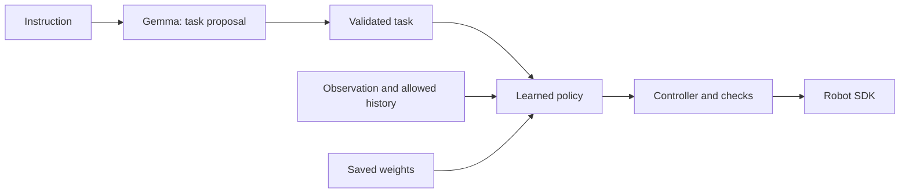

# Implementation and reproduction

This guide covers the published robot-policy case study. The research goal and target AI-led loop are described in the [project introduction](../README.md). 한국어 연구 개요는 README, 실행 계약과 재현 조건은 이 문서를 기준으로 읽습니다.

## 1. Runtime and training are separate



The training path computes a loss, calls `loss.backward()` and `optimizer.step()`, and saves a checkpoint. Runtime instruction parsing does not itself perform learning or authorize motion. Some planning paths combine learned predictions with bounded symbolic search.

## 2. Choose the correct model contract

The repository contains multiple model families. Their checkpoints are not interchangeable.

| Entry | Contract or boundary |
|---|---|
| [Trajectory training](../raccoon_memory/scene_trajectory_training.py) | Joint-position and velocity MSE, weighted gripper cross-entropy and terminal BCE; saves `trajectory_student.pt`. |
| [Scene policy](../raccoon_memory/scene_policy.py) | Observation history → action logits and four normalized absolute joint targets. |
| [Numbered-slot models](../raccoon_memory/neural.py) | Architecture/configuration plus `state_dict`; different from the trajectory checkpoint family. |
| [Recall and planning](../raccoon_memory/inference.py) | GRU state across observations; a new write resets it. Recall has a documented 48-step scope. Optional search assistance is separate. |
| [Task proposals](../raccoon_memory/task_program.py) | Bounded task validation, not robot dispatch. |
| [Robot bridge](../raccoon_memory/robot_bridge.py) | Expected object state is distinct from observed physical success. |

### Selected public checkpoint

The [HF model card](https://huggingface.co/DreamingLizard/llm-driven-robot-policy-learning) identifies `selected_policy.pt` as the same artifact as [the selected GitHub weight](../models/조작_학생_선정_20261030.pt), not Gemma or an RL candidate.

- SHA-256: `48170fc8aa8e05b231115367fb2960f9a8f69920c359cf3019472d5c911d3977`.
- Format: `terra-native-source-distance-close-evidence.v1`.
- Loader: [`load_student_checkpoint`](../raccoon_memory/terra_native_close_evidence.py).
- Input: 8 × 82 observation history, validity mask, preceding applied joint targets and actions.
- Output: four action logits and four joint targets in degrees, with geometry-mode proposals.

Use its matching loader. This custom PyTorch model is not a Transformers pipeline.

## 3. Two small checks, two different claims

| Check | Requires | Establishes | Does not establish |
|---|---|---|---|
| Symbolic state smoke | Python ≥3.11, this repository | Move/restoration, 80-value encoding, duplicate-ID rejection | Learned inference, physics or hardware |
| Selected-model smoke | Matching HF checkpoint + loader ZIP, PyTorch | Strict load and synthetic CPU output shape/finite values | Valid task behavior, benchmark quality or physical success |

### A. Symbolic state

Clone the repository, or use GitHub **Code → Download ZIP** and extract it. From its root:

```sh
python -m examples.offline_world_smoke
```

Expected output:

```text
PASS: symbolic move, restoration, 80-value encoding, invalid-state rejection
1/2/3/4 -> -/21/3/4 -> 1/2/3/4
Not tested: learned weights, LLM inference, physics, or hardware.
```

A slash separates slots; `21` means cylinder 1 is above cylinder 2. This check was verified on 2026-11-13 with Python 3.12.14 in a separate cloud workspace. No SDK or model download is needed.

### B. Selected-model loader

For a fixed, documented check, use [HF revision 377387a](https://huggingface.co/DreamingLizard/llm-driven-robot-policy-learning/tree/377387ae089d4482d03dad060f7926ba86c19ac2). Download `selected_policy.pt` and `offline_loader.zip` from that same revision into one directory, then extract the ZIP. With PyTorch installed:

```sh
python offline_smoke.py
```

The model card reports `PASS: strict checkpoint load and synthetic CPU shape/finite smoke only` on 2026-11-14. The reported environment was Python 3.14.3 and PyTorch 2.11.0+cu130; outputs were [1,4] action logits and [1,4] joint targets, both finite. All-zero synthetic input is not a valid robot task.

This pinned check is historical evidence, not a claim that it is the newest loader. Current GitHub source and the fixed HF ZIP may differ. Do not mix versions and assume compatibility. Full clean-environment installation, retraining and physical reproduction are not established by either smoke check.

## 4. How to read the evidence

- Recorded-observation accuracy and target errors are not closed-loop success. See `RECORDED_METRIC_SCOPE` in the scene-policy source.
- Source-grouped trajectory validation is not an independent final holdout. Separate training, model selection and final evaluation by original provenance.
- Trajectory termination uses `apply_then_finish`: apply the last output before stopping.
- A physical demonstration needs trial counts, conditions and observations before it can support a success-rate claim.
- LLM-assisted settings/code, optimizer updates and direct LLM-generated weight deltas are different mechanisms. The last mechanism and the complete autonomous production loop remain research goals.

## 5. Versions, downloads and reuse

Use [the paper index](../papers/PUBLISHED_VERSION.md) for the latest bilingual DOI and historical versions. Use [the package guide](../PUBLIC_PACKAGE_README.md) for the frozen source ZIP, evidence archives and missing reproduction inputs. Paper version, code commit and weight hash are separate identifiers.

No code/model license is assigned here. The paper's CC BY 4.0 does not automatically cover code, weights or datasets; third-party terms remain applicable. Neither smoke command operates motors. Hardware use requires separate validation and safeguards.
