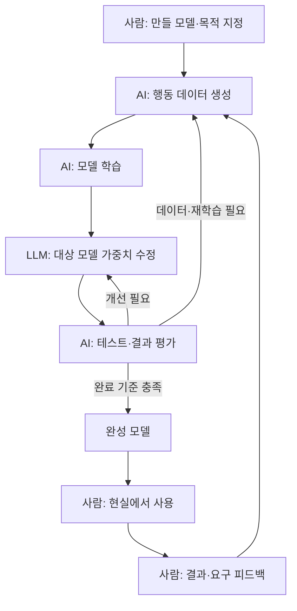
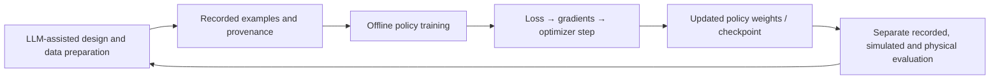
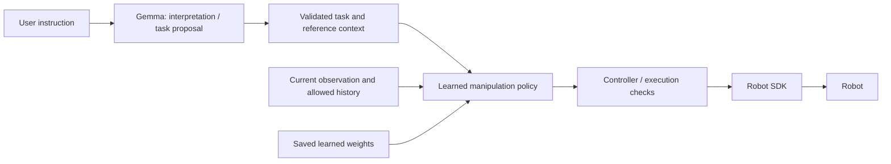

# Technical entry guide / 기술 구조와 첫 실행

**AI-assisted model creation, with robot policy learning as the first case study.**
The broader hypothesis is that AI participation in data preparation, training and weight improvement could help people produce more validated task-specific models. The present code provides a robot-policy case study, not evidence that this scales to all models. Optimizer-based updates, LLM-generated learning code, and direct generation of weights or weight deltas are different mechanisms; the latter is not established here. See the [research direction and planned comparisons](../README.md#후속-연구--next-research).

**비전은 AI가 학습과 가중치 개선에 참여해 더 많은 검증된 모델을 만드는 것입니다. 로봇 조작 모델은 첫 사례입니다.**
다만 “LLM이 개발을 돕는다”, “학습기가 가중치를 갱신한다”, “실행 중 Gemma가 명령을 해석한다”는 서로 다른 단계입니다.

**아이디어의 출발점:** LLM이 LLM의 가중치를 개선한 연구를 소개한 기사에서, “LLM이 피지컬 AI 로봇 모델의 가중치를 수정해 개선하면 어떨까?”라는 질문으로 이어졌습니다. 이는 연구 동기이며 해당 기사·원 논문은 아직 식별하지 않았으므로 추정 인용하지 않습니다.

**Origin:** An article describing research on LLM-driven improvement of LLM weights prompted the question of applying weight improvement to physical-AI robot models. The article and original paper are not identified here.

## Target architecture / 목표하는 전체 고리

**사람은 만들 모델과 목적을 정하고, 완성된 모델을 현실에서 사용한 뒤 피드백합니다. 중간 제작 과정은 AI가 주도하는 것이 목표입니다.**



이 그림은 **최종 비전**입니다. AI가 데이터 생성부터 학습·가중치 수정·테스트 반복을 주도하고, 사람의 실제 사용 피드백을 다음 개선으로 연결하는 구조입니다. 여기서 수정 대상은 만들고 있는 모델의 가중치이며, 로봇 사례에서는 조작 모델입니다. 목표는 사람이 중간 단계마다 코드를 고치고 학습을 다시 지시하는 개입을 최소화하는 것입니다. 사람의 안전 승인·중단 권한을 없앤다는 뜻은 아닙니다.

**확장 방향:** 라쿤봇은 첫 사례입니다. 같은 제작·개선 고리를 서로 다른 목적과 다른 로봇에 적용해, 각각에 맞는 모델을 더 많이 생산하는 것이 목표입니다. 동일 가중치를 모든 로봇에 그대로 옮기는 것이 아니라, 대상의 입력·출력·데이터·시험 조건에 맞춘 모델 제작을 뜻합니다. 이후 다른 종류의 모델까지 확장할 수 있는지는 별도로 검증할 가설입니다.

**Expansion goal:** Minimize manual intervention inside the AI-led development loop while retaining human safety oversight. Extend the process to task-specific models for different robots, and eventually investigate other model types. This is a model-production goal, not a claim of universal weight transfer or already demonstrated scale.

**현재 확인된 구현과의 차이:** 공개 코드에는 학습 손실·역전파·옵티마이저에 의한 가중치 갱신이 있습니다. LLM이 가중치 또는 변화량을 직접 생성·적용하는 단계와 위 전체 고리의 자율 작동은 아직 공개 자료로 입증되지 않았습니다. 완성 판정 기준, 사람의 승인·개입 경계, 실제 사용 피드백의 검증 방식도 후속 연구에서 정해야 합니다.

**English:** People specify the model and its purpose, then use the finished model in the real world and provide feedback. The intended AI-led middle loop is behavior-data generation → training → LLM modification of the target model's weights → testing and repeated improvement. Real-use feedback returns to that loop. This is the target architecture, not a claim that the published optimizer-based code already implements direct LLM weight editing or the autonomous end-to-end cycle.

## 1. Published-code paths / 현재 코드의 개발·실행 구분

The diagrams are conceptual maps of the published source, not proof that every experimental variant uses the same runtime.





**한국어 요약:** 개발 단계는 데이터 → 학습 → 가중치 갱신 → 평가입니다. 실행 단계는 Gemma → 조작 모델 → 제어기·SDK입니다. 이 저장소에는 여러 실험 경로가 있으므로, 위 그림만으로 모든 실행이 순수 신경망 제어이거나 매번 온라인 학습한다고 해석하면 안 됩니다.

## 2. Where the weight update actually happens

| Question | Source entry | What it shows |
|---|---|---|
| Does training modify model weights? | [scene_trajectory_training.py](../raccoon_memory/scene_trajectory_training.py), `train` | Computes a loss, calls `loss.backward()` and `optimizer.step()`, then saves `trajectory_student.pt`. |
| What does that trajectory learner optimize? | Same module | Joint-position MSE + velocity MSE + weighted gripper cross-entropy + terminal binary cross-entropy. |
| What is a saved model? | [neural.py](../raccoon_memory/neural.py), `load_model`; [train.py](../raccoon_memory/train.py), `save_model` | The numbered-slot models store architecture/configuration and `state_dict`; loading restores weights and switches to evaluation mode. This is a different checkpoint family from the trajectory student. |
| What can a manipulation model output? | [scene_policy.py](../raccoon_memory/scene_policy.py), `ScenePolicy.forward` | History-window input; action logits and four normalized absolute joint targets. |
| Where is remembered state represented? | [inference.py](../raccoon_memory/inference.py), `LearnedRecall` | GRU hidden state is retained across observations; an explicit new write resets the old hidden state. |
| Is every plan purely neural? | Same module, `LocalPlanner.plan` | First attempts a learned policy; optional bounded symbolic search is reported separately as search assistance. |
| Does language parsing itself move the robot? | [task_program.py](../raccoon_memory/task_program.py) | Produces and validates bounded task-program proposals; does not dispatch robot commands. |
| Is controller completion an observed success? | [robot_bridge.py](../raccoon_memory/robot_bridge.py) | Explicitly distinguishes expected object state from observed physical success. |

The optimizer changes learned policy parameters. The published code does **not** establish that Gemma directly writes arbitrary neural-network weight values. Likewise, the presence of LLM-assisted development does not mean all labels come from an LLM: the trajectory module documents replay-derived labels and direct-command variants with distinct provenance.

**가중치 수정의 의미:** 학습 데이터와 손실을 바탕으로 학습기가 모델 파라미터를 갱신합니다. “Gemma가 가중치 숫자를 직접 써 넣는다”는 주장과는 다릅니다. 데이터 출처도 경로별로 구분해야 합니다.

## 3. First runnable check: no robot and no model download

This is deliberately a small **symbolic representation smoke check**, not a learned-policy demonstration. It gives a newcomer a safe first executable entry point without installing the SDK, downloading weights, or starting training.

Download this repository with Git (or GitHub's Code → Download ZIP and extract it). With Git:

```sh
git clone https://github.com/dreaminglizard/llm-driven-robot-policy-learning.git
cd llm-driven-robot-policy-learning
```

From that repository root, with Python 3.11 or newer:

```sh
python -m examples.offline_world_smoke
```

Expected output:

```text
PASS: symbolic move, restoration, 80-value encoding, invalid-state rejection
1/2/3/4 -> -/21/3/4 -> 1/2/3/4
Not tested: learned weights, LLM inference, physics, or hardware.
```

Each slash separates a registered slot. Stack IDs are written bottom to top: `21` means cylinder 1 is above cylinder 2. The example moves cylinder 1 from A to B, reverses that move, verifies the 80-value representation, and checks rejection of duplicate object IDs.

**검증 범위:** 2026-11-13, Python 3.12.14의 별도 클라우드 작업공간에서 공개된 `world.py`와 `__init__.py`를 사용해 위 출력을 확인했습니다. 모델 가중치·LLM·물리 시뮬레이터·실물 성공률 검사는 아닙니다. 이 확인에는 모터 작동이나 새 학습이 없습니다.

## 4. What the evidence does and does not establish

- **Recorded-observation metrics:** next-action accuracy / target error on saved observations. They do not establish closed-loop or physical success. See `RECORDED_METRIC_SCOPE` in [scene_policy.py](../raccoon_memory/scene_policy.py).
- **Trajectory validation:** grouped by original source, but explicitly not an independent final holdout. Small errors on these records are not evidence of generalization to new robots or environments.
- **Memory boundary:** `LearnedRecall` rejects recall beyond the documented 48-step sequence scope. A new explicit write replaces the remembered episode.
- **Terminal boundary:** trajectory training documents `apply_then_finish`: stopping before applying the last output creates a one-tick mismatch.
- **Physical demonstration:** a successful demonstration is valuable, but it must not be presented as a measured success rate without a trial count, conditions and observations.
- **Current verification here:** only the small symbolic smoke check above was executed. Full clean-environment installation, pretrained inference, training reproduction and physical testing were not performed for this guide.

No performance number or demo video has been invented. This guide intentionally does not turn source-code assertions into measured benchmark results.

## 5. Reading order / 권장 탐색 순서

1. [Offline example](../examples/offline_world_smoke.py): understand the four-slot task representation.
2. [World representation](../raccoon_memory/world.py): states, moves, encoding and constraints.
3. [Model definitions](../raccoon_memory/neural.py) and [scene-policy definitions](../raccoon_memory/scene_policy.py): distinguish the model families.
4. [Trajectory training](../raccoon_memory/scene_trajectory_training.py): data labels, weight updates, saved checkpoint and stated limitations.
5. [Inference](../raccoon_memory/inference.py): learned inference, retained memory and optional search.
6. [Task-program interface](../raccoon_memory/task_program.py) and [robot bridge](../raccoon_memory/robot_bridge.py): language-to-task boundary and execution boundary.

This guide grants no new license and changes no third-party terms. It is a technical entry point, not a replacement for the repository's existing introduction or publication history.
