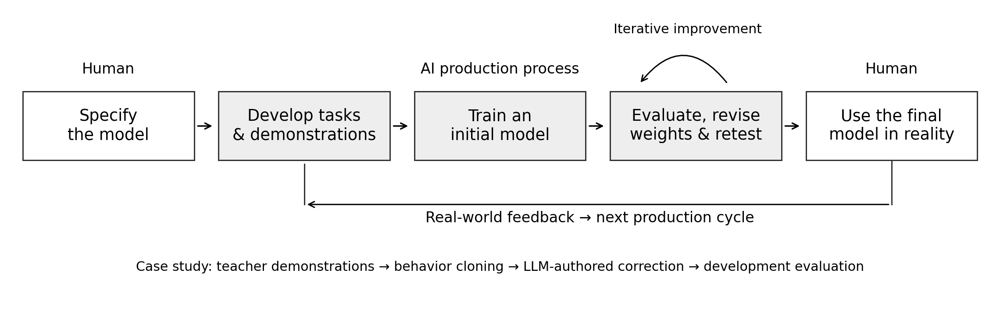
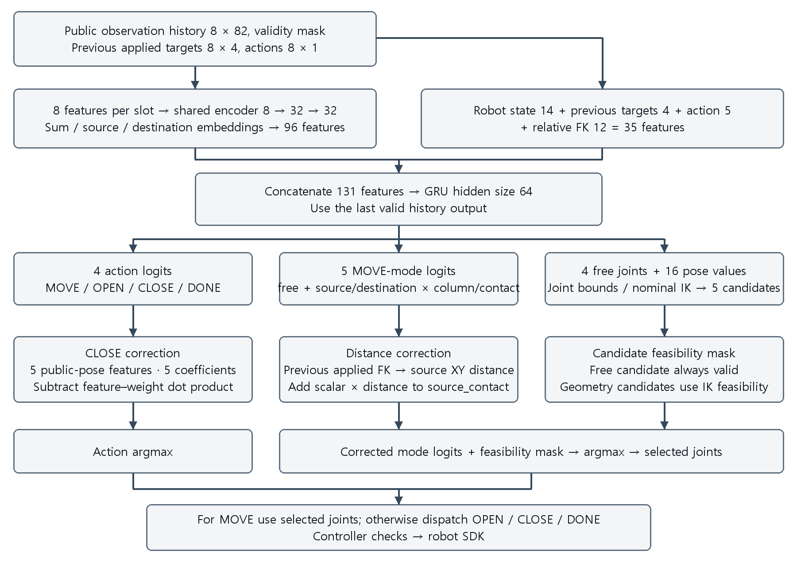
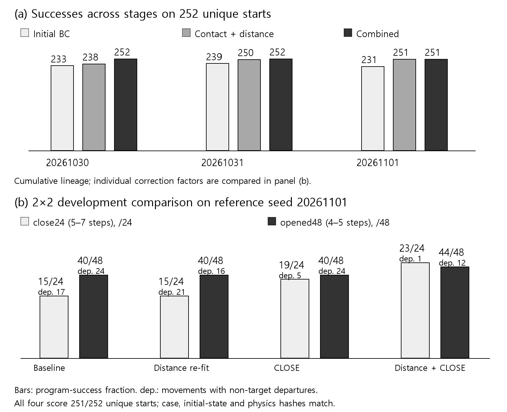

# Robot Model Construction through LLM-Generated Behavior Data and Iterative Weight Improvement

유용현

Mechatronics Engineering, Tech University of Korea (한국공학대학교 메카트로닉스·AI로봇 전공)

CC BY 4.0 — https://creativecommons.org/licenses/by/4.0/

## Abstract

Building a robot model requires repeated data collection, policy training, failure analysis, and modification. This work places the LLM in the role of model producer and proposes a production loop connecting behavior-data generation to improvement of the trained model's weights. A person initially specifies the desired model and provides feedback from real-world use of the resulting model, while AI performs the intermediate generation, training, modification, and testing. In the first case, RaccoonBot, demonstrations from a tool-using teacher train a geometrically integrated GRU policy, and the LLM designs, implements, and executes correction procedures to produce candidate weights. Numerical updates use AdamW, demonstration-frequency-based distance estimation, and Newton-based CLOSE correction. In stored simulated development evaluations, successes for the selected seed increased from 233/252 (initial BC) and 238/252 (existing approach-distance policy) to 252/252 unique starts, and from 12/24 to 24/24 conditions for seven- to eight-step programs. In a 2×2 component isolation on the reference seed, combining distance re-estimation with CLOSE correction improved five- to seven-step close24 and four- to five-step opened48 program successes from 15/24 to 23/24 and from 40/48 to 44/48, respectively, exceeding either single correction. These results document the model-production method and its gains on the recorded development conditions. Follow-up research will compare improvement mechanisms and human intervention under matched budgets and investigate reuse of the production loop across robots and purpose-specific models.

Keywords: LLM, physical AI, model production, behavior-data generation, weight improvement, imitation learning.

## 1. Introduction

Making a robot move once and building a model capable of performing that task are different problems. The former selects the next command in a given state; the latter determines what data to collect, what to learn, and how to repair an unsuccessful model. If an LLM can undertake this production process, the human role could shift from manually connecting individual learning stages to specifying the desired model and returning feedback from actual use.

This research began with an article reporting that Astra had improved a language model by modifying its weights. The resulting question was whether an LLM could also improve a robot model for physical AI. We formulate this as a single production loop: behavior-data generation → initial policy training → LLM-led weight modification and testing → final model. Feedback from real-world use becomes input to the next improvement cycle. The long-term objective is not completion of one robot, but repeated application of this process to build models for different robots and purposes with less intermediate human intervention. Within this process, we also investigate whether advances in the LLM’s perception and reasoning about the physical world could enable it to analyze how model parameters affect actual behavior and directly edit the relevant weights to produce a desired capability. The long-term application targets of this production loop include humanoids with bimanual manipulation, dexterous hands, and whole-body coordination.

RaccoonBot is the first case exploring this direction. This paper connects demonstration provenance, applied commands, policy architecture, weight changes, and evaluation results to explain what was built and what improvement was observed. The LLM designs the improvement, writes the code, and executes it. We describe separately how that code computes the weights. Recording both the acting agent and the numerical update method enables analysis of which improvement procedures can be reused.

The paper makes three contributions. First, it presents a model-production structure connecting data generation and post-training improvement to real-world feedback. Second, it describes an implementation linking teacher demonstrations, a compact manipulation policy, and LLM-led correction under a common action specification, together with stored development results. Third, it defines comparisons needed to extend this case into the complete production loop. Current empirical evidence consists of simulated development evaluation for one robot and limited physical observations; production efficiency and cross-embodiment generalization remain research questions.

## 2. Related Work

### 2.1 From Data to Manipulation Policies

Behavior cloning maps demonstration observation–action pairs into a policy. Differences between the demonstration distribution and the states produced by a policy during execution cause sequential error accumulation; DAgger is a representative approach to this problem [1]. ACT and Diffusion Policy advance manipulation learning through action chunks and conditional action-sequence generation, respectively [2,3]. RT-1, Open X-Embodiment, and Octo demonstrate the use of large-scale real demonstrations and multi-robot data [4–6]. The present case focuses on the process of producing a small policy rather than competing in performance with these generalist policies.

Scaling Up and Distilling Down generates demonstrations through language-model planning and robot tools, then distills them into policies [7]. GenSim, RoboGen, GenSim2, and AnyTask expand automation of tasks, environments, data, and learning [8–11], while MimicGen generates additional data from a small demonstration set [12]. LLM-based data generation and policy learning are thus an established research direction. We treat this direction as part of a production process connected to repeated improvement of the learned policy.

### 2.2 Improvement Loops and Weight Updates

SEAR connects agent-generated experience to policy improvement in three modes: code-as-policy, agent-as-policy, and auto-research. In auto-research, the agent collects and curates teacher-code rollouts, fine-tunes π0.5, evaluates it, and chooses the next experiment [16]. Its controls distinguish retained experience from independent retries under a matched total budget. Robo-COP likewise connects execution, demonstration curation, fine-tuning, candidate verification, and policy-dependent memory revision during deployment [17]. These studies establish prior examples of integrated data generation, learning, and repeated evaluation.

Weight-Space Programming investigates a different question: whether an LLM can select changes to numerical weights directly. The original research blog reports edits to Qwen3.5-0.8B [13]; robotics studies examine lexical grounding through π0.5 embedding edits [14] and small-policy construction and editing [15]. These methods differ from an LLM designing and executing a numerical fitting procedure, as in the present case. Both can belong to an iterative production process, but their update mechanisms need separate comparisons.

Our case starts from newly initialized compact policy weights, rather than the pretrained VLA used in SEAR's auto-research mode and Robo-COP. It documents teacher demonstrations, geometry-integrated learning, and LLM-authored corrections for a limited manipulation setting. This establishes a compact-policy case alongside the pretrained-model systems. The broader objective is repeated production of purpose-specific models from a person's model specification and subsequent real-use feedback. Whether that process reduces intervention and transfers across robots remains to be tested.

## 3. Model-Production Framework

Figure 1. The proposed production loop. A person specifies the model and provides feedback from real-world use. AI develops the tasks, demonstrations, training, and iterative improvement process. The lower row identifies the path documented in this case.

A model specification describes the intended capability and its operating range. Within that scope, AI would construct tasks and demonstration scenarios, generate and curate behavior data, train an initial policy, and repeatedly revise and test candidate weights. Test failures can lead back to data generation or training rather than only to a local parameter change. A completed model is delivered with its execution specification, then feedback from a person's real-world use informs the next production cycle. The intended human role is concentrated at these two ends, not at every intermediate experiment.

Developing useful tests is part of production, but judging the finished model is a separate responsibility. AI may construct development tasks and checks; the producer must not redefine success after seeing a candidate or inspect the final test cases. A fixed external evaluation protocol provides evidence beyond the producer's own practice. This separation permits autonomous development without treating self-assessment as proof of competence.

The reusable unit is the production procedure: how tasks, demonstrations, corrections, and test outcomes inform the next candidate. Retained skills and failure knowledge may support later models, while joint configurations, coordinates, grippers, sensors, and control timing require robot-specific adapters. Reuse of a procedure does not imply that identical weights or action labels transfer across robots.

The present case implements teacher-generated data, behavior cloning, LLM-led correction, and development evaluation. It does not establish autonomous task-and-evaluator construction, an intervention-free end-to-end run, or repeated production driven by real-use feedback. Sections 4 and 5 describe the implemented path; Section 6 defines experiments for the wider loop.

Table 1. System components and interpretation boundaries.

| Layer | Role | Interpretation boundary |
|---|---|---|
| Teacher and collector | Observe scenes, select tool actions, and save demonstrations | Teacher success is not student success |
| Data conversion | Link observations, applied commands, derived labels, and lineage | Converted row counts are not independent demonstration counts |
| Student policy | Predict action type, geometric role, and correction values | Distinguish a system including nominal IK from a neural network alone |
| Layout memory and command execution | Manage memory state and compound-command order | A mock student-integration check is not successful object manipulation |
| Robot adapter and controller | Convert units, ranges, and timing, then transmit commands and check state | Request, transmission, arrival, and success are separate events |
| Evaluator | Judge target and non-target objects, hold duration, and termination state | Student DONE alone does not establish success |

## 4. Case-Study Implementation

### 4.1 Tasks, Observations, and the Action Contract

The tasks manipulate cylinders among four registered slots: moving to an empty location, stacking, unstacking, and transferring between towers. The student uses joint and gripper state, the task, registered and predicted scenes, nominal slot coordinates, and public action history. The registered scene is an initial arrangement supplied by the user; the predicted scene is an estimate updated from commands. Actual object coordinates, contacts, and success judgments are not student inputs, so joint feedback alone cannot resolve objects moving differently from the prediction.

The teacher submits MOVE with joint angles or XYZ, OPEN, CLOSE, or DONE together with an `observation_id`. The inspected collector exposes four joint angles; sensor validity and `moving`; gripper commands, reports, and freshness; the registered scene, XY coordinates, and task; nominal FK of observed angles and the preceding applied target; the previous action; and the recent 8-frame `window/mask`. XYZ is converted through nominal IK; command duration is 1 second and ramp duration is 0.5 seconds [P7,P9].

Observations, policy proposals, range-handled targets, and actually applied commands are recorded separately. Subsequent SDK compensation targets do not overwrite the history in policy coordinates. DONE represents the policy's intention to terminate, not command completion or object-level success. This action contract connects teacher data to student execution. Appendix C describes the scope of historical collector verification and subsequent control checks.

### 4.2 Demonstrations and Lineage

The training data comprise 1,000 successful forward demonstrations and 770 successful trajectories derived through reverse replay. The originals were selected retrospectively from 445 legacy, 22 v2, and 533 v2.1 cases. Their 12,328 rows and the 9,363 reverse rows total 21,691, including 16,381 MOVE and 1,770 CLOSE rows [P1,P7]. The 1,770 trajectories are not all new sequences of direct teacher decisions; derived data retain their original parents.

Selection used direct commands, simulator command returns, DONE, official completion records, and simulated success over 501 samples, excluding abnormal termination. Original `label_eligible:false` metadata were preserved; a subsequent reviewed manifest determines actual training inclusion. Comparison back to original-session actions covers two cases; the remainder underwent stored-row hash and count checks. Collection success rate is not calculated because totals for all attempts, failures, and discarded cases are unconfirmed.

### 4.3 Geometrically Integrated Recurrent Policy

The currently selected policy processes observations from the most recent 8 time points. Each observation has 82 features: 14 for joint and gripper state, 16 for the task, 44 for the registered scene, and 8 for XY coordinates. These are combined with the preceding 4 joint targets in policy coordinates and a 5-category representation of the previous action. SDK compensation targets and policy targets are separated according to the action contract above [P1].

The per-slot features encode XY coordinates, occupancy at two levels, whether the slot matches the object being moved, and source/destination roles. The active-ID field in the 82-dimensional frame is not directly connected to a separate GRU input in the base encoder. The 8-dimensional features of each slot pass through a shared 8→32→32 encoder. The 96-dimensional pooled representation of all slots, the source slot, and the destination slot is combined with 14 robot-state dimensions, 4 previous applied-target dimensions, 5 previous-action dimensions, and a 12-dimensional relative FK vector, giving a 131-dimensional GRU input. The manipulation-policy GRU has a hidden size of 64 and is distinct from a separate GRU for arrangement memory. Each call uses the last output of the valid history and does not persist an additional hidden state between calls. The 8 time points are a history of action-decision boundaries, not a uniformly sampled 20 ms time series.

The outputs comprise 4 action categories, 5 MOVE modes, 4 free joint targets, and 16 pose-related values. The initial model has 41,053 trainable parameters. The subsequent combined candidate adds 1 distance scalar and 5 CLOSE coefficients, giving 41,059 in total; 8 statistical buffers are distinguished from trainable parameters [P1].

The action categories are MOVE, OPEN, CLOSE, and DONE. For MOVE, the policy selects either a free target or one of four geometric candidates corresponding to source/destination `column/contact` roles. The four role-based candidates predict (x, y, z, pitch) relative to the registered center and are transformed to joint space using nominal analytic inverse kinematics with the positive-radius, negative-elbow solution. XY corrections are bounded to ±12 mm on each axis; column height is 85±90 mm; contact height is object center+5±15 mm; and pitch is bounded to ±8 degrees. Invalid candidates are excluded from selection, while `free` proposes a target within the joint limits. This policy therefore differs from an end-to-end joint regressor that uses no geometric structure.

Figure 2 separates the recurrent feature construction, parallel output heads, and the two runtime correction locations. The 131-dimensional GRU input is formed after slot encoding. The 41,053 → 41,054 → 41,059 counts denote trainable parameters, while Table 3 reports task outcomes.

Figure 2. Implemented policy and runtime corrections. Distance correction adjusts the source_contact mode logit before feasible-candidate selection. CLOSE correction adjusts only its action logit. Public pose and action history supply correction features. Section 4.4 describes coefficient fitting separately [P1].

### 4.4 Initial Training and LLM-Led Improvement

Initial training uses behavior cloning from newly initialized weights; the selected lineage uses seed 20261030. The technical specification lists the following base configuration: AdamW, learning rate 0.001, weight decay 0.01, batch size 128, 3,000 updates, and gradient clipping at 1. Original object IDs are retained, and no ID-substitution augmentation is used. The subsequently demonstration-corrected lineage was selected [P1].

The objective combines action cross-entropy, MOVE-conditional mode cross-entropy, Smooth L1 losses for role-based and free joint targets, an FK position loss, and a pose loss. Smooth L1 uses beta=1. The weights and normalization units in the specification are as follows.

Table 2. Components of the base behavior-cloning objective.

| Loss term | Weight and normalization | Applicability |
|---|---|---|
| Action classification | CE(action) | Corresponding action label |
| MOVE mode classification | CE(mode) | MOVE rows |
| Role-based joint target | 0.70 × SmoothL1, 9-degree scale | Corresponding supervision mask |
| Free joint target | 0.15 × SmoothL1, 18-degree scale | Corresponding supervision mask |
| FK position | 0.35 × SmoothL1, 8 mm scale | Corresponding position supervision |
| Pose | 0.40 × Lpose | Normalization by 4 mm·4 mm·4 mm·3 degrees; contact weight ×2 |

Mode labels are `source_contact` when the next record for the same movement is CLOSE and `destination_contact` when it is OPEN. Otherwise, a target whose FK lies within 0.5 mm in XY of the nearer registered center with an absolute pitch of at most 1 degree is labeled with the corresponding `column`; all others are `free`. Next-action information constructs labels and is not an execution input. Loss masks, reduction methods, random-generator states, and code versions needed for reproduction are listed as reproduction requirements in Appendix A.

After training the base network, all other weights were frozen (Figure 2, bottom) and the bias of the `source_contact` mode was corrected by +0.069870711. A distance coefficient of −0.869019 was then learned and subsequently re-estimated from the contact frequency of the original MOVE rows, giving −1.027451. The distance term computes d=min(distance/20 mm, 8) from the XY distance between the FK of the preceding applied target and the registered source point, and adds coefficient×d to the `source_contact` score. The re-estimate is the difference between endpoint log odds, divided by 8, using pre-contact proportions at distances of at most 0.5 mm and at least 160 mm, with 0.5 pseudo-observations per class. Five CLOSE coefficients were then fitted. At each correction stage, all weights other than the relevant coefficients were held fixed, and new physics-evaluation outcomes were not used as teacher labels [P1].

The CLOSE correction uses five features: two amounts by which the XY errors from the FK of the previous applied target and of the current observation to the source point exceed the maximum XY error in the original CLOSE rows; two amounts by which Z falls outside the demonstrated CLOSE-height range; and one indicator that the preceding action is not MOVE. XY exceedances are normalized by 20 mm. Z exceedances are normalized by the larger of the interquartile range of demonstrated heights and 1 mm.

The inner product of the features and coefficients is subtracted from the CLOSE score, while the other action scores and joint-candidate calculations remain unchanged. The training objective is the sum of BCE with the original CLOSE-versus-other-actions log odds as an offset, plus 0.5‖w‖². The selected coefficients obtained by damped Newton's method are approximately [0.09894, 0.09811, 0.76021, 0.74287, 0.53654]. This correction does not directly change the other scores, but can change the final action selection.

The LLM designed, coded, and executed these corrections. Archived Astra development records document creation and successful execution of distance-correction, CLOSE-correction, and multiseed reproduction code [P13]. This is therefore LLM-led improvement, with numerical updates implemented through AdamW, closed-form estimation, and Newton optimization. Direct LLM selection of individual tensor values is a future comparison condition. Because development failures informed design and selection, the following results are reported as development performance.

## 5. Evaluation and Results

### 5.1 Evaluation Conditions

The principal comparison is simulated development evaluation of each seed's existing approach-distance policy against its combined distance-and-CLOSE candidate. It uses 252 unique starts, 12 five- to seven-step programs × 2 conditions, and 6 seven- to eight-step programs × 4 conditions. The sets share some starts, and training seeds differ from physics seeds. Inspection of public task structures found all 15 in the training data [P4]. The results therefore concern improvement on existing development conditions rather than generalization to new task structures.

Success requires target-object position and stability and preservation of non-target objects across 501 temporal samples over 1 second after DONE. The simulations use MuJoCo 3.17.0 with a 2 ms physics step; long-horizon conditions vary friction, servo stiffness, mass, pads, and positions. Numerical thresholds and condition settings appear in Appendix C. Temporal samples are not independent trials, and object outcomes are classified as success, failure, or undetermined.

### 5.2 Combined-Correction Results

Table 3. Success counts from initial behavior cloning → existing approach-distance policy → combined candidate. Column headings give denominators; parentheses show movements with non-target cylinder departures on unique starts. Remaining cases were failures, and unique-start sets have 0 undetermined outcomes [P3,P14].

| Training seed | 252 unique starts (Initial BC → Existing → Combined) | 5–7 steps, 24 cond. (Existing → Combined) | 7–8 steps, 24 cond. (Existing → Combined) |
|---|---|---|---|
| 20261101 | 231 → 251 → 251 (dep. 3→0→0) | 15 → 23 | 12 → 20 |
| 20261030, selected lineage | 233 → 238 → 252 (dep. 3→1→0) | 18 → 23 | 12 → 24 |
| 20261031 | 239 → 250 → 252 (dep. 5→0→0) | 13 → 21 | 8 → 23 |

Tracking cumulative gains from freshly initialized behavior cloning (41,053 parameters) on the 252 unique starts, the selected seed 20261030 progressed from 233/252 (3 non-target departures) to 238/252 (1 departure) and 252/252 (0 departures), while seed 20261031 progressed from 239/252 (5 departures) to 250/252 (0 departures) and 252/252 (0 departures) [P14]. On the reference seed 20261101, unique-start success rose from initial BC 231/252 (3 departures) through an intermediate contact-bias calibration step at 246/252 (4 departures) to 251/252 (0 departures) for both the existing approach-distance and combined candidates [P14].

On long-horizon programs for the selected seed 20261030, successes changed from 18/24 to 23/24 for five- to seven-step programs and from 12/24 to 24/24 for seven- to eight-step programs; individual-movement successes were 131/144→143/144 and 132/180→180/180, with non-target cylinder departures falling from 4→0 and 28→0. Programs and individual movements are separate units. The three initializations share the same original parents and development set, reusing exactly matching existing evaluations for seed 20261101 and refitted corrections for the other two seeds [P3]. Because long-horizon evaluations for 20261030 and 20261031 directly compare the existing approach-distance baseline with the combined candidate, individual causal contributions of distance re-estimation and CLOSE correction are examined on the reference seed in Section 5.3.

### 5.3 Correction Checks, Component Isolation, and an Alternative Candidate

To separate the contributions of distance re-estimation and the five CLOSE coefficients, we examined the stored 2×2 ablation on reference seed 20261101 starting from its existing approach-distance policy (Table 4, Figure 3) [P15]. The four variants share case identities and initial-state and physical-parameter hashes. Existing results were reused where matched; CLOSE variants were subsequently evaluated from the same starts.

Table 4. 2×2 isolation of distance re-estimation and CLOSE 5-coefficient correction on reference seed 20261101 [P15].

| Candidate condition (seed 20261101) | 252 unique starts (dep.) | 5–7 steps close24 /24 (moves, dep.) | 4–5-step opened48 /48 (moves, dep.) |
|---|---|---|---|
| Baseline (existing approach-distance, −0.8690) | 251/252 (0) | 15/24 (110/144, dep. 17) | 40/48 (192/216, dep. 24) |
| Distance re-estimation only (−1.0275) | 251/252 (0) | 15/24 (110/144, dep. 21) | 40/48 (192/216, dep. 16) |
| CLOSE 5 coefficients only | 251/252 (0) | 19/24 (128/144, dep. 5) | 40/48 (192/216, dep. 24) |
| Combined (distance re-estimation + CLOSE) | 251/252 (0) | 23/24 (140/144, dep. 1) | 44/48 (204/216, dep. 12) |

All four conditions achieved 251/252 on unique starts (269/270 moves, 0 non-target departures), while the combined candidate performed best on both program suites. Distance re-estimation alone reduced non-target cylinder departures on four- to five-step `opened48` from 24 to 16 (3→1 across all four profiles of `long_n4_04`) without raising program success (40/48), and left close24 success unchanged at 15/24 while departures increased from 17 to 21. Conversely, CLOSE correction alone raised `close24` from 15/24 to 19/24 (departures 17→5) without changing `opened48` (40/48, 24 departures). Combining both raised both suites together, reaching 23/24 on `close24` (140/144 moves, 1 departure) and 44/48 on `opened48` (204/216 moves, 12 departures). Because this 2×2 isolation was run on reference seed 20261101, separate single-factor magnitudes on seeds 20261030 and 20261031 were not isolated.

Figure 3. (a) Cumulative success counts from initial BC through contact-and-distance correction to the combined candidate, on 252 unique starts per seed. (b) Distance re-estimation × CLOSE correction on seed 20261101. opened48 contains 24 four-step and 24 five-step conditions; close24 has eight conditions at each of five, six and seven steps. Departures count individual movements, not failed programs [P14,P15].

On the 200 original parents comprising 4,366 rows withheld from CLOSE-coefficient fitting, binary log loss decreased from 0.005178 before correction to 0.003768 after correction [P1]. This is a before-and-after comparison on the same rows, not an effect attributed to withholding them. Because these parents had been used in base BC, the comparison checks the correction stage rather than providing an independent final test.

For a separate `source-approach` starting model with seed 20261101, unique-start successes were 251/252 for the starting policy, 248/252 with additional BC, and 247/252 with BC+RL, with 0 undetermined outcomes in every condition [P5]. The comparison used the same initial weights and BC minibatches for 1,000 updates; RL combined terminal-reward on-policy REINFORCE with BC. This candidate was not selected. Its starting checkpoint differs from the selected final model in Table 3, so it is not an RL extension of that model.

### 5.4 Physical Observations and System Integration

The physical records provide execution cases rather than repeated success rates. On November 7, 2026, stacking cylinder 3 on cylinder 1 involved a pause, user inspection, correction of the execution reference, history restoration, and resumption; the user confirmed the stack. On November 11, execution stopped before OPEN because of joint-tracking deviation and was recovered by the operator [P6]. On November 12, 8 movement and 2 gripper commands reached the actual SDK; arrival, termination, and stopping were recorded, and the user confirmed correct stacking [P12]. Automatic object verdicts for the two successful observations were `null`, and episode-specific weight matching for the latter case was not confirmed.

A later development case illustrates how real-use feedback can guide a system revision. On November 13, the user reported cylinders being pushed during grasping and misaligned after stacking. Inspection of six execution-event sequences and joint telemetry led to a low-altitude speed cap in the controller: at most 8% when the lower of the starting and target heights is below 60 mm, or at most 12% for a joint change greater than 68 degrees. Higher motions retain the requested speed. The change passed 164 mock tests [P16].

This case closes the observation–diagnosis–code-revision segment of the production loop. It changes the control layer, not policy weights. The running physical instance had not been restarted with the revision and no subsequent hardware validation was recorded. Historical 30% and 8% telemetry came from different conditions, so it is useful for diagnosis rather than a matched estimate of the speed cap’s effect. The next step is paired physical trials with the same starting arrangement and task, recording joint tracking, object displacement, completion and human intervention.

Simulated SDK stacking, unstacking, and synthetic-speech return are separate control-integration checks. They use separately initialized scenes and are not pooled as continuous execution in one world or as real-speech or physical performance. Detailed states and verdicts appear in Appendix C. The quantitative results in the main text are the simulated development evaluations in Tables 3 and 4.

## 6. Discussion and Research Agenda

### 6.1 What the Case Shows about Model Production

The LLM's role extended beyond generating execution commands as a teacher: it analyzed post-training failures, developed corrections, and produced candidate weights. This yields a concrete path for treating data generation and model improvement as one production process. Observed performance nevertheless belongs to the combination of slot encoder, GRU, kinematics, corrections, and controller. The matched 2×2 comparison identifies the two correction factors on one reference seed; the contributions of geometry, recurrence and the controller call for separate comparisons.

Current observations use registered and predicted arrangements without vision, and evaluation concentrates on repeatedly exposed development conditions. Physical evidence is limited to a small number of user-confirmed cases. The supported result is improvement within this system and these conditions; independent generalization, lower production cost, and intervention-free autonomy remain open questions. Compound tasks preserving memory and object state during execution, transition prediction, control latency, and safe interruption must also be evaluated as parts of the production process.

### 6.2 Comparing Improvement and Retained Experience

Two comparisons address different questions. To isolate improvement mechanisms, data generation and initial training are held common, followed by four conditions: no further improvement; predefined optimization without LLM intervention; LLM-designed, coded, and executed improvement; and direct LLM selection and testing of numerical parameter changes. The second versus third comparison tests improvement design, while the third versus fourth tests the update mechanism. Permitted data, objectives, and resource ceilings are shared, with actual compute, model calls, environment interactions, and elapsed time reported.

To test the complete production process, the model specification is held fixed while AI constructs development tasks, demonstrations, and tests within the permitted scope. Following SEAR's distinction between inheritance and resampling [16], a run retaining experience from earlier models is compared with a fresh run and with several independent restarts sharing the same total budget. Restart selection uses development validation only, never final-test scores. The source of inherited data, code, memory, and checkpoints is recorded; the cost of producing that inheritance is reported separately and included in total and amortized production costs. Repeating the entire production process, rather than only evaluating one successful checkpoint repeatedly, measures reliability.

Candidate acceptance and stopping rules are fixed before comparison. Verification covers both intended improvements and previously acquired capabilities, following the concern addressed by Robo-COP [17]. A candidate's own success is distinguished from completion through a fallback. AI-designed practice tasks are separated from locked final cases, and real-use feedback becomes development data once used for revision. Original demonstrations, reverse trajectories, retries, and other descendants remain in the same split. Results include success, failure, and undetermined outcomes; model-production time; and the duration and frequency of human intervention. Statistical inference respects shared lineage and repeated-use dependencies.

Table 5. Future controlled comparisons of production-loop components.

| Validation question | Comparison conditions | Main measurements |
|---|---|---|
| Contribution of geometry | Free-target model versus integrated model with the same data and budget | Per-task S/F/U; joint and object errors |
| Contribution of derived data | Forward only versus forward+reverse, with lineage-grouped splits | Outcomes from unseen initial states; transition prediction |
| Contribution of public history | With versus without previous applied targets and action history | Execution rejection; tracking error; success |
| Memory and continuity | Single movement versus compound commands in the same world | Completion of the full command; intermediate failures and recovery |
| Cross-embodiment extension | Reimplementation and training of the same procedure on another arm | Data budget; adaptation cost; per-robot performance |

### 6.3 Physical Understanding and Purpose-Specific Model Production

A long-term hypothesis is that advances in an LLM’s perception of the physical world could help it connect observed situations and failures to changes in a model’s parameters. If the LLM can analyze and understand the relationship between parameters and actual behavior, it may be able to target relevant weights and produce a model with the desired performance through direct weight modification alone. Here, “alone” means using direct edits rather than additional gradient-based training at that improvement stage. It does not dispense with demonstrations and training for the initial model, testing of the edits, or feedback from real-world use.

This is a research hypothesis, not an ability established by the present results. Better perception does not automatically yield an understanding of weight effects: the behavioral changes predicted by the LLM before an edit must be checked in actual tests. From matched starting models and budgets, targeted edits should be compared with no edit, control edits, and numerical optimization, measuring both performance in new situations and preservation of existing capabilities. Analysis and revision experience that passes these checks could then inform production of subsequent models.

Connecting this vision to repeated production across robots and purposes first requires validating reuse of the procedure rather than transplantation of identical weights. Episode specifications, lineage, model selection, and evaluation can be shared, while joint count and limits, FK and IK, gripper semantics, sensors, and control latency need robot-specific checks. Six-axis arms and vision additionally require image–joint temporal alignment, camera calibration, handling of occlusion and capture-time arm pose, and uncertainty in object estimates. Labels and adapters must change with the action representation. The aim is to repeatedly apply a production loop in which a person specifies the desired model and returns real-use feedback, while AI connects demonstration generation, training, direct editing or optimization, and evaluation. Cost and performance on other robots, shared policies, and zero-shot transfer require separate validation.

### 6.4 Humanoid Extension and Cumulative Development

The intended extension reaches beyond a single robot arm to humanoid bimanual manipulation, dexterous-hand manipulation, and ultimately whole-body coordination combining locomotion and manipulation. The central proposal is not to transplant the current RaccoonBot weights unchanged, but to reapply the production procedure to more complex embodiments and purposes: AI generates behavior data, defines and evaluates tasks, improves model weights, and evaluates and revises the improved model again. A person specifies the desired capabilities and operating conditions, uses the resulting model, and feeds that real-world experience into the next improvement cycle.

What accumulates in this process is not only individual behavior, but production experience about which data to generate, which failures to test, and which modifications to select. If validated experience can be reused to produce subsequent models and tackle harder tasks, adding a capability need not remain an isolated development effort; it may help produce further capabilities. In this work, the vision of vertical development in robotics means raising capability levels from individual actions to compound manipulation and whole-body tasks through accumulated model-production competence. The rate and sustainability of that development are quantities to measure across repeated production runs.

Extension to humanoids must address action representations and control interfaces for the arms, hands, torso, and legs; temporal alignment of vision, touch, and proprioception; contact and balance; and collision and fall risks. Follow-up research would expand from a single arm to bimanual and dexterous-hand tasks, and then to whole-body tasks involving locomotion, comparing experience-retaining production with fresh starts under matched budgets. Evaluation would jointly measure new-task performance, retention of existing capabilities, human intervention, total production cost, and safety. These staged tests would establish the scope of humanoid applications for the production procedure introduced in the RaccoonBot case.

### 6.5 VLA Production and Extension of the Model-Production Approach

The long-term vision of this work is to apply the production loop to building and improving vision–language–action (VLA) models themselves, creating robot foundation models shared across multiple robots and tasks. AI would generate data linking visual observations, language instructions, and actions; design training tasks and evaluation conditions; analyze observed failures; and revise the VLA training data and weights before reevaluation. Repeated evaluation and revision of the improved model, together with feedback from human use, would form a development process for building and continually improving a general-purpose base model. This role goes beyond using a pretrained foundation model to generate commands or fine-tuning it for a single task: it concerns producing and improving the shared base model itself for multiple robots and tasks.

Experience from producing purpose-specific policies could inform the training and improvement of a shared VLA model, which could in turn be adapted to individual robots and humanoid tasks. Testing this cycle requires connecting observation and action representations across embodiments and managing the quality and distribution of generated data. Evaluation should jointly measure generalization to held-out robots, environments, and tasks; retention of existing capabilities; human intervention; and computational cost. The RaccoonBot case motivates this extension, while its effectiveness for large-scale general-purpose model production remains a question for follow-up experiments.

The broader vision is not tied to VLA or any particular model family. AI would construct data and tasks for a given purpose, use evaluation and failure analysis to improve training data, weights, and evaluation procedures, and incorporate feedback from human use into the next production cycle. Data representations, learning methods, and evaluation criteria will differ across models; if the iterative structure and accumulated production experience can be reused, what scales is not just one model but the capability to produce models. VLA is a concrete robotics setting for this vision, while extension to other model families should be evaluated in terms of domain-specific performance and production cost.

## 7. Conclusion

This work proposes extending the LLM's role from generating robot commands to producing robot models. The RaccoonBot case connects teacher demonstrations, geometrically integrated policy learning, and LLM-designed and executed correction, with increased success for the combined candidate in stored simulated development evaluation. This case provides an initial basis for implementing and evaluating the full production loop.

The objective is for a person to specify the model and provide real-world usage feedback, while AI generates behavior data and repeatedly trains, modifies weights, and tests to produce purpose-specific models. Future work will measure independent performance and human intervention across this complete process and validate reuse on another robot. The central question is not only how well one model can be improved, but how reliably the process of producing good models can be repeated. In the longer term, we aim to apply this production loop to building and improving VLA models themselves, connecting AI-driven behavior-data generation, task design and evaluation, failure analysis, data and weight revision, and reevaluation with feedback from real human use. The goal is to build a robot foundation model shared across robots and tasks and extend this process to humanoids with bimanual manipulation, dexterous hands, and whole-body coordination. We will test whether this cycle allows improvements in individual capabilities to contribute to the shared model and to the cumulative development of subsequent capabilities. More broadly, we aim to extend this into an AI-led model-production approach that is not limited to a particular model family, accumulating not only model performance but also the capability to produce new models.

## References

[1] Ross, S., Gordon, G., and Bagnell, D. “A Reduction of Imitation Learning and Structured Prediction to No-Regret Online Learning.” AISTATS, PMLR 15, 627–635, 2011. https://proceedings.mlr.press/v15/ross11a.html

[2] Zhao, T. Z., Kumar, V., Levine, S., and Finn, C. “Learning Fine-Grained Bimanual Manipulation with Low-Cost Hardware.” Robotics: Science and Systems, 2023. https://roboticsproceedings.org/rss19/p016.html

[3] Chi, C., et al. “Diffusion Policy: Visuomotor Policy Learning via Action Diffusion.” Robotics: Science and Systems, 2023. https://roboticsproceedings.org/rss19/p026.html

[4] Brohan, A., et al. “RT-1: Robotics Transformer for Real-World Control at Scale.” Robotics: Science and Systems, 2023. https://roboticsproceedings.org/rss19/p025.html

[5] Open X-Embodiment Collaboration. “Open X-Embodiment: Robotic Learning Datasets and RT-X Models.” IEEE ICRA, 6892–6903, 2024. https://doi.org/10.1109/ICRA57147.2024.10611477

[6] Ghosh, D., et al. “Octo: An Open-Source Generalist Robot Policy.” Robotics: Science and Systems, 2024. https://roboticsproceedings.org/rss20/p090.html

[7] Ha, H., Florence, P., and Song, S. “Scaling Up and Distilling Down: Language-Guided Robot Skill Acquisition.” CoRL 2023, PMLR 229, 3766–3777, 2023. https://proceedings.mlr.press/v229/ha23a.html

[8] Wang, L., et al. “GenSim: Generating Robotic Simulation Tasks via Large Language Models.” ICLR, 2024. https://arxiv.org/abs/2310.01361

[9] Wang, Y., et al. “RoboGen: Towards Unleashing Infinite Data for Automated Robot Learning via Generative Simulation.” ICML, PMLR 235, 51936–51983, 2024. https://proceedings.mlr.press/v235/wang24cc.html

[10] Hua, P., et al. “GenSim2: Scaling Robot Data Generation with Multi-modal and Reasoning LLMs.” CoRL 2024, PMLR 270, 5030–5066, 2025. https://proceedings.mlr.press/v270/hua25a.html

[11] Gong, R., et al. “AnyTask: an Automated Task and Data Generation Framework for Advancing Sim-to-Real Policy Learning.” arXiv:2512.17853, 2025. Version checked: v2, 2026-01-20. https://arxiv.org/abs/2512.17853

[12] Mandlekar, A., et al. “MimicGen: A Data Generation System for Scalable Robot Learning using Human Demonstrations.” CoRL 2023, PMLR 229, 1820–1864, 2023. https://proceedings.mlr.press/v229/mandlekar23a.html

[13] Takehi, R., Teoh, J., Zhang, A., and Khattab, O. “Sparks of Weight-Space Programming: LLMs can natively read & write neural network weights.” Research blog, 2026-11-02. https://rikiyat.github.io/blog/weight-space-programming/

[14] Zhang, J., Wang, K., and Lin, L. “Can LLMs Debug Robots by Editing Their Weights?” arXiv:2611.09376, 2026-11-06. https://arxiv.org/abs/2611.09376

[15] Playground research. “A First Glance At Weight-Space Programming for Robotics.” Research note, November 2026. https://www.withplayground.ai/blog/weight-space-robotics

[16] Wang, X., Li, B., Wang, H., Zhang, L., Cui, A. Y., Tang, Z., Buch, S., and Xu, D. “SEAR: Self-Evolving Agentic Robotics.” arXiv:2610.18792v1, 2026-10-13. https://arxiv.org/abs/2610.18792

[17] Zhang, X., Wang, M., Bauer, E., Yu, H.-X., Huang, H., Wu, J., and Pavone, M. “Co-Evolving Robot Orchestrators and Policies through Deployment.” arXiv:2610.09228v1, 2026-10-06. https://arxiv.org/abs/2610.09228

[P1–P16] Identifiers for implementation and experimental records from this study. Appendix B specifies document and checkpoint versions and the scope of verification. The correspondence between published material bundles and individual evidence records must be checked separately. Publication of some files does not imply publication of all raw records or completion of independent reproduction.

## Appendix A. Reproduction Specification and Versions

Table 6. Items to retain in a reproducible release.

| Item | Contents to retain |
|---|---|
| Robot specification | Degrees of freedom; joint order, units, limits, and kinematics; gripper; firmware and SDK versions |
| Data | Original identifiers; parents of derived samples; retries; direct teacher decisions; applied commands; timestamps; outcomes |
| Inputs and labels | Observable and privileged information; normalization; masks; timing; scope of future-information use |
| Model | Architecture; learned parameters and buffers; checkpoint SHA-256; selection criteria |
| Training | Split lists; random seeds; optimizer settings; correction stages; actual code commit |
| Evaluation | Initial states; arrangements; coordinates; physics seeds; exposure status; S/F/U; reasons for interruption |
| Physical execution | User intervention; resumption status; device arrival; object-level assessment; safe interruption path |

The earlier bilingual manuscript is archived on Zenodo (https://doi.org/10.5281/zenodo.24212741); public code and research materials are accessible through https://github.com/dreaminglizard/llm-driven-robot-policy-learning. Executable reproduction of the saved evaluations also requires reconstruction of the corresponding code, environment, model, and data. The verified version matches and remaining recovery gaps are described below.

Comparison of the 258 source hashes recorded in the close24 evaluation against the working copy at inspection yielded 251 matches and 7 mismatches. Subsequent searches recovered historical versions of scene_features.py, scene_ramped_motion_sim.py, and scene_custom_slots_sim.py from an existing preserved execution directory and confirmed that their SHA-256 hashes matched the original evaluation [P10]. Matching versions of the remaining files, scene_model_session.py, scene_program_coordinator.py, task_program.py, and task_program_v2.py, were not found within the search scope, which included 284 candidate project files and 8 ZIP archives. This does not prove that copies do not exist elsewhere.

Static comparison of the recovered and current versions identified differences in observation-encoder dependencies, optional finger/closed-MOVE interpolation and cancellation handling, and checks that permit historical states. The names, order, and numerical expressions of the first 14 observation features, as well as observation validation, are identical in the source, but the new observation-only function omits additional task validation present in the earlier function. The settings compared by the current class's state-compatibility check also omit the new finger/closed-MOVE profiles. Consequently, neither the fact that some historical states can pass this compatibility check nor agreement in observation dimensions establishes equivalence of input validation, control-target time series, or evaluation results. This static comparison alone also cannot determine whether each change actually affected the historical results.

Hash checks of the accompanying partial copy yielded 3 matches, 4 mismatches, and 251 files not supplied. Here, “not supplied” does not mean that files were lost from the original project, and these counts should not be combined with the earlier full-working-copy comparison to claim complete reconstruction of the historical environment. Recovery of three historical source files and regeneration of tables from saved results are complete, but executable reproduction, including unrecovered sources and the actual dependencies, configuration, model, and data, remains outstanding. No new training, simulation, or physical reruns were performed for this revision.

## Appendix B. Identification of Result Evidence

P1. “RaccoonBot Technical Specification,” Sections 6.1–6.6. The revision dated 2026-11-11 UTC was used. Its technical contents were checked against the model and training code and the selected checkpoint. The document SHA-256 is f39d7de0709635e2f251363719855049edf5d6c4443f798fb5965f1fc655c2ff.

The selected model uses seed 20261030 and format terra-native-source-distance-close-evidence.v1. Its checkpoint SHA-256 is 48170fc8aa8e05b231115367fb2960f9a8f69920c359cf3019472d5c911d3977. A file with the same name but a different hash should not be assumed to be the model underlying the numerical results in this paper.

P2. The researcher's log summary of the 2026-11-07 direct-trajectory experiment, a nonpublic record. This is a historical diagnostic record from a separate model lineage, not an independent verification of the complete raw logs. Public raw data accessible to readers are not included in this bundle.

P3. Saved results for three seeds with combined corrections: artifacts/architecture_research/astra_close_reproduction_three_seeds_20261106_v1/three_seed_verification.json, seed_20261030/result.json, and seed_20261031/result.json. The first seed, 20261101, reuses fit.json and distance_and_action/result.json from artifacts/architecture_research/astra_native_close_evidence_20261106_v1/. The success counts in the paper were checked against the original JSON files. They are not results of newly rerun training or evaluation.

P4. Inspection of training exposure to public task structures for the selected model: artifacts/architecture_research/terra_direct_prefix_extended_development_20261106_v1/20261030_학습_공개그룹_집계.json. This confirms training exposure to 15 public structures. It does not establish whether nonpublic physics seeds are exact duplicates.

P5. Development comparison for a separate RL candidate: artifacts/architecture_research/native_approach_adaptive_rl_v1/development_v2/geometry_mixed/full/summary.json. The starting model SHA-256 is 06f198d501c93c2e247d8e55c839a88015e1fdaa9f79941540b2d1278f3a5c89. Its lineage is distinguished from that of the selected model; 251, 248, and 247 are the success counts across 252 development starts for the starting policy, additional BC, and BC+RL, respectively.

P6. “Evidence and Verification of the Project's Core Claims” and the project's physical-experiment progress record dated 2026-11-11 21:23 KST. The user-confirmed physical case on November 7 is distinguished from the interrupted-control and recovery state on November 11. Physical results are based on the descriptions in the official documents; this analysis did not independently verify all underlying physical logs or the device.

P7. Record dated 2026-11-10 verifying the provenance of training demonstrations: docs/테라_시연과_선정모델_학습출처_확인_20261110.md. This distinguishes original metadata, subsequent selection lists, comparisons of original actions in two sessions, and hash and row-count checks of the remaining stored rows. The connection in weight lineage was checked in docs/아스트라_가중치_선정모델_반영_확인_20261110.md.

P8. Evidence for evaluation settings and versions: Sections 5.2 and 5.6 of docs/라쿤봇_기술명세서.md, modified at 2026-11-11T12:50:08.0462216Z, SHA-256 17a270b32ba6477d0ba2e242f00d9b55b51d1576d37f9f2b312f7fcbb9db6200. This is distinguished from the 12:25:11 version in P1. Numerical criteria were checked against raccoon_memory/scene_motion_sim.py; physics settings against configs/sim/raccoon_pick_place.xml; and long-horizon conditions against scripts/prepare_astra_long_generalization.py, scripts/astra_payload_pad_generalization.py, and their corresponding plan.json files. Comparing the stored hash list in close24 assignment.json with current files establishes code changes, not reproduction of the historical execution.

P9. Current public collector and execution-range handling: scripts/collect_public_tower3_full_teacher.py and raccoon_control/near_joint_limit_policy.py. These code checks explain the collector contract and manually implemented joint-limit handling; they do not certify that the same version was used in every historical session.

P10. Record of historical-source recovery and static comparison with the current version. The reference is artifacts/architecture_research/astra_close_reproduction_three_seeds_20261106_v1/close24/assignment.json, with SHA-256 95002367f92f5684345896ae469812f996aa066a58731c6381962f6f4613923a. Three historical source files were recovered from preserved copies in .evaluation_runtime/20261103_applied_action_s0_pilot_v1/raccoon_memory/. The accompanying source_recovery/recovery_manifest.json records hashes, provenance, and inspection times for each file; search_scope_summary.json records the search scope; and source_change_comparison.md records static differences and limitations. These materials are a partial copy, not evidence that project execution or the complete results have been reproduced.

P11. Saved control-development records inspected at 2026-11-11 14:11 UTC. The files used were stack_memory_sdk_v5.json, unstack_memory_sdk_v5.json, and voice_return_memory_sdk_v3.json in artifacts/physical/astra_control_redesign_20261111_v1/. The directory name physical is not interpreted as evidence of physical execution. Original-file hashes, inspection scope, and excerpts of assessment fields are recorded in the accompanying docs/controller_development_evidence.json. This is verification of simulated SDK development cases, not a newly rerun evaluation.

P12. A single user-confirmed physical stacking case on 2026-11-12. The inspected control-log hashes, assessments, user confirmation, and verification scope are recorded in the accompanying docs/physical_user_confirmed_case_20261112.json.

P13. Archived Astra development task, 2026-11-06 10:13:10–13:12:15 KST. Official task retrieval confirmed completed creation of fit_astra_distance_evidence.py, fit_astra_close_evidence.py, and reproduce_astra_close_evidence_seeds.py and successful termination of the three executions. This establishes the LLM’s authorship and execution of the method and code, not a completed unseen evaluation or physical experiment. The retrieved response did not expose an exact backend model identifier; the task label Astra is not treated as verification of that identifier.

P14. Staged 252-unique-start development results from initial BC through contact and approach calibration across three seeds. For seeds 20261030 and 20261031, records were checked against artifacts/architecture_research/astra_native_geometry_multiseed_v1/verified_summary.json (SHA-256 9ed9213d91eddb15a1e386813e8ceb8c2fa6cecbf6c84e3045aa2de00c50bf68) and each seed's initial/mixed/result.json and finished/result.json. Seed 20261030 initial BC checkpoint is 639af0d8a5b6937923ca5d617aafd96e267ed75caa9fe596c63359b82642fff5 (233/252, 3 departures) and existing approach-distance checkpoint is 46ea14c56c8c2d6940d2e6b70b50d82ec17d10f17d1a2c65a50a529285bc068c (238/252, 1 departure); seed 20261031 initial BC checkpoint is a58ef0cf944e42cafe6e88ed4889b5de6ffa5e46941957ad3514086c2b4f6993 (physical_summary_sha256 e5b9411a76ff28e8fafd57868aaa0fe5390db00588de59e43657a60cfe01e842, 239/252, 5 departures) and existing approach-distance checkpoint is a9a33a137fa801bbcbf24bde9d1f474d0f7469398cd74cb478ffcc2dd33df297 (250/252, 0 departures). For reference seed 20261101, initial BC (231/252, 3 departures, checkpoint 0822bdbab25410003d3df670575ad858b41eea6176d04836a2d34872d58cfff6) is documented in artifacts/architecture_research/astra_native_geometry_v1/development/independent_verification.json and development/both/full/summary.json, and the intermediate contact-bias calibration stage (246/252, 4 departures, checkpoint d41395ba1d49b91d1ec1e8f788120cb57d71cfbdb481d6b215169a753a856077) in artifacts/architecture_research/astra_native_geometry_contact_calibration_v1/development/independent_verification.json and mixed/full/summary.json.

P15. 2×2 isolation of distance re-estimation and CLOSE 5-coefficient correction on reference seed 20261101: artifacts/architecture_research/astra_native_close_evidence_20261106_v1/paired_verification.json (SHA-256 362524a03cb4141b02cfbc323eca7a8defcb33eb11996ec28f3f8afdd63d6a8e). Counts on fixed252, new24_verified (close24), and opened48 were checked against the original JSON for reference (06f198d501c93c2e247d8e55c839a88015e1fdaa9f79941540b2d1278f3a5c89), distance_only (893082e3672b17631e127c97151649e7cd0daf8da5d1628178b6510c0ee2512f), action_only (aff6131f7447058afd66360ed838c9020a746f887e91965e63a8620ee38a09af), and distance_and_action (071c6d1bbdf6cd0128ad7586c82f91e9bbaf8163c18ce3a2829d91db05f3ba7c).

P16. 2026-11-13 10:55 KST 50 Hz physical telemetry diagnosis and low-height contact speed limit record. Control logs are .runtime/hardware-app/events.jsonl (SHA-256 27d71afbdbbe80b84980260fdf7d7fb10ff9c5928c4babe2248c1c69aa5b6e2d) and telemetry.jsonl; speed-cap implementation is in raccoon_memory/native_physical_student.py (_direct_contact_speed_pct, SHA-256 4b7b934a71b1f748946b2276cbc91e0e59aaeed9dafeaf7dadcabdafff89ce52), checked against tests/test_native_physical_student.py and the Handoff.md entry dated 2026-11-13 10:55 KST (164/164 simulated/fake-SDK unit and integration checks passed; physical stacking not yet re-tested under the speed cap).

## Appendix C. Evaluation and Execution Details

### C.1 Simulated Development Evaluation Settings

The stored simulated development evaluation in Table 3 requires all success conditions to hold across all 501 samples spanning 1 second after DONE, including the initial time point and every 2 ms boundary [P8]. At each sample, gripper opening must be at least 25 mm, the target cylinder's XY error relative to its goal must be at most 12 mm, and its height error must be at most 5 mm. A second-level target additionally requires an XY error of at most 8 mm relative to the cylinder underneath and a relative height of 20±3 mm. A non-target cylinder must have an XY displacement of at most 8 mm and height change of at most 3 mm relative to its anchor, while remaining within 12 mm in XY and 5 mm in height of its registered slot. The anchor is initialized to the actual position and restored from the stored anchor when state is restored. It is subsequently updated to the actual position at the end of success adjudication.

Every cylinder must satisfy an upright-direction cosine of at least 0.9659, linear speed of at most 0.01 m/s, and angular speed of at most 0.3 rad/s. The normal force from the intended support must be positive, and there must be no contact with the robot or unintended contact between cylinders. These are operational definitions for this development evaluation, not universal success criteria for all robot tasks. The 501 temporal samples are not counted as 501 independent trials.

The project's dependency specification lists MuJoCo 3.17.0. Physics-scene settings use a 2 ms time step, the `implicitfast` integrator, and 100 solver iterations. Across the 48 saved initial states of the two long-horizon evaluations, every file hash matched its corresponding plan, and the recorded MuJoCo version was also 3.17.0. This verifies stored states, not a revalidation of the complete execution environment or historical trajectories. The two `close24` conditions are `reference` and `offset_coupled`; the latter combines friction at 0.8 times nominal, stiffness of the four arm servos at 0.9 times nominal, and an additional horizontal displacement of 3 mm. The four `factor24` conditions are `reference`, `payload_high`, `pad_asymmetry`, and `payload_and_pads`. `reference` preserves the existing per-seed randomization values: friction, mass, and inertia at 0.8–1.2 times nominal, and servo stiffness at 0.9–1.1 times nominal. `payload_high` replaces cylinder mass and inertia with 1.20 times their nominal values. `pad_asymmetry` replaces the sliding, torsional, and rolling friction of one finger pad with 0.80 times nominal and of the opposite pad with 1.20 times nominal. The lower-friction side is assigned per program, with 3 programs on each side. The combined condition applies both modifications. For the additional displacement, cylinders are translated together by a 3 mm vector in a random direction for each slot, without changing the registered XY coordinates. These are specified simulated development stress conditions, not a measured distribution of physical devices. Agreement between code and physics-scene versions is addressed separately in Appendix A.

### C.2 Control-Adapter Development Cases

Subsequent controller-development records inspected through November 11, 2026, 14:11 UTC connected the same selected checkpoint to a MuJoCo·PD control path through an in-memory SDK encoder and simulated transport [P11]. Stacking and unstacking v5 each terminated with `model_done`, recording `task_success=true` and success on the 501-sample evaluation. Both cases used fixed development conditions with seed 620028 and the `hold_servo_target` simulated stopping model, but began separately from different initial arrangements and states. They are therefore not counted as sequential stacking followed by unstacking in the same world or as a success rate for that sequence. Both records have `hardware_connected=false` and `physical_success=null`; they are not evidence of execution on the actual device.

Synthetic-speech return v3 also recorded `task_success=true`, success on the 501-sample evaluation, `execution.status=retargeted_expected`, and `execution.retarget.status=completed_expected`. This test checks the execution path using a fixed synthetic audio source and a predetermined transcript; it does not validate the performance of a real microphone or speech recognition. Because it began from a separately initialized tower arrangement, it is not treated as continuous execution connected to the earlier stacking case. Command planning includes non-learned symbolic search, and return to the origin includes control logic based on registered references. The result is therefore not attributed to end-to-end learning from speech to action. These individual development cases provide evidence only for integration of the manipulation policy, controller, and command execution, and are not added to the development sets in Table 3.

The earlier unstacking v3 ended with `end_unconfirmed` and `task_success=null`, although the diagnostic-only 501-sample evaluation succeeded. This illustrates that diagnostic success of the object state after interruption can differ from program completion. The changes from v3 to v5 include multiple controller-code revisions, so the causal effect of a single change cannot be isolated. Moreover, stacking/unstacking v5 and synthetic-speech return v3 have different controller and student-execution-adapter fingerprints. The three cases are therefore not presented as a set rerun with the same final code [P11].

### C.3 Diagnostics from the Separate Direct-Trajectory Lineage

Manipulation data contain many intervals in which the same gripper command is maintained. In the report from a separate direct-trajectory study, only 14 of 9,425 internal validation samples contained actual gripper transitions, and none of the three candidates predicted those transitions. Overall gripper agreement of 9,411/9,425 matched the baseline that simply retained the preceding command [P2]. This illustrates why high aggregate classification accuracy does not guarantee useful manipulation transitions. These results are not interpreted as the gripper performance of the currently selected model.

Transition evaluation should report missed and unnecessary transitions separately for OPEN and CLOSE, using one-to-one matching within a prespecified time window. Increasing the training emphasis around transitions is worth considering, but probabilities obtained with oversampling should not be interpreted as naturally occurring probabilities. Controlled comparisons are needed to determine which changes improve success.

The direct-trajectory lineage distinguished 20 ms stored samples from the teacher's decisions about velocity intervals. Signed velocity was integrated into position-servo targets every 2 ms, making a stored starting target a value derived during application rather than a separate teacher-specified angle [P2]. This lineage differs from the selected policy in model, data, and control period.

### C.4 Scope of Collection and Control Verification

Original collection data indicate complete windows for 12,282 rows and partial windows for 46 rows; the latter were supplemented through a public reread at the same time point. The inspected code contract does not certify all historical prompts, collector versions, external-information access, or server-side teacher-model identity [P7,P9].

Each of the subsequent stacking and unstacking v5 records preserved the distinction between policy targets and SDK compensation targets across 10 decision transitions [P11]. Observation, decision, transmission, application, and completion times are recorded separately. Converting applied targets to the policy representation and back checks representational consistency. Diagnostic object evaluation after control interruption is likewise distinguished from the final task verdict.

In simulated execution, targets exceeding declared joint limits by no more than 1 degree on every axis are clipped to the boundary; larger violations are rejected. This development-derived rule is not a tracking-error criterion or a physical-safety standard [P9]. Actual stopping after communication loss, SDK queue handling, and collision risk require separate on-site verification.

