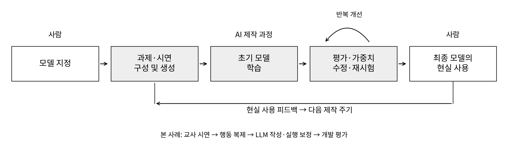
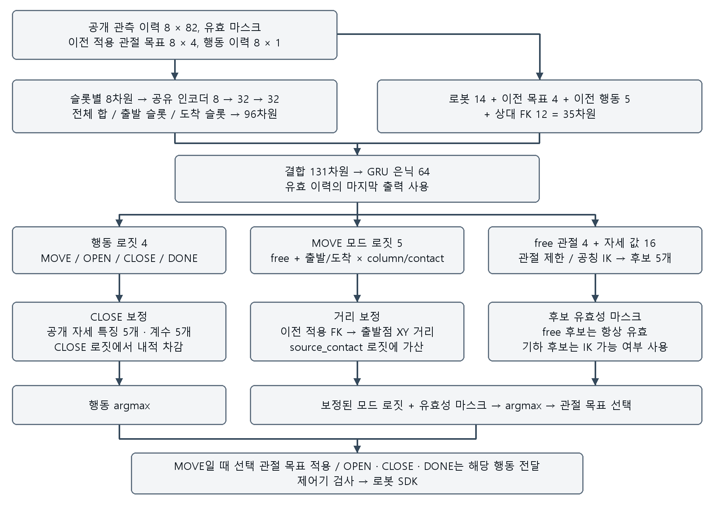
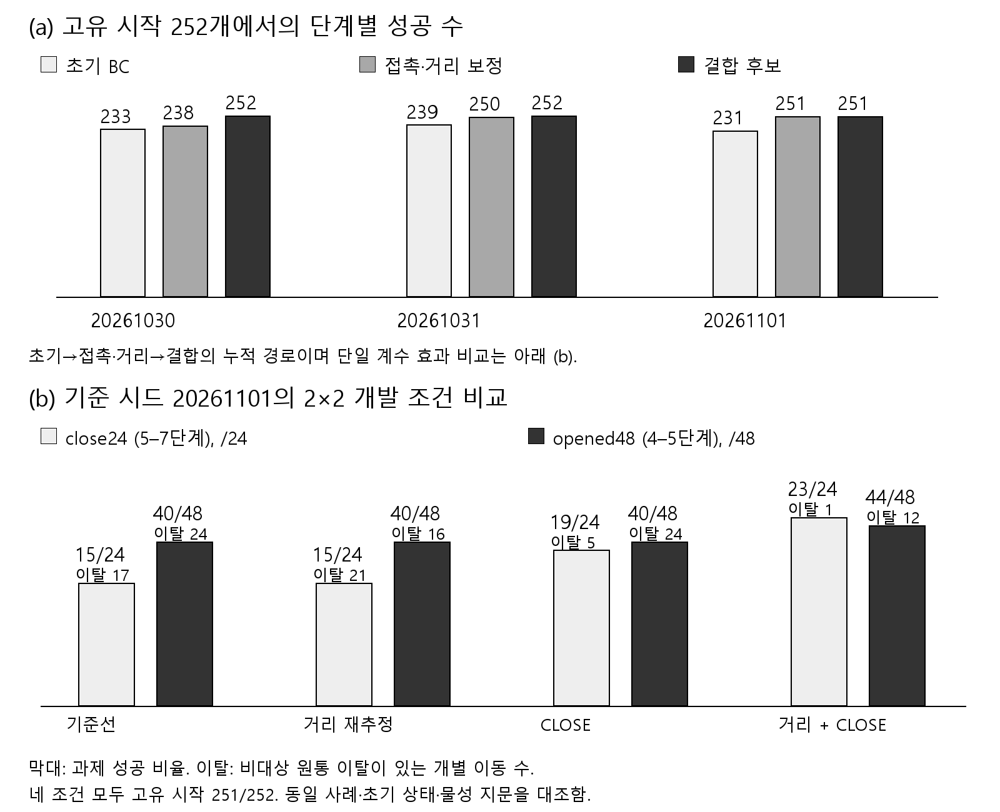

# LLM의 행동 데이터 생성과 반복 가중치 개선을 통한 로봇 모델 제작

Robot Model Construction through LLM Generated Behavior Data and Iterative Weight Improvement

유용현

한국공학대학교 메카트로닉스·AI로봇 전공

CC BY 4.0 — https://creativecommons.org/licenses/by/4.0/

## 초록

로봇 모델의 제작에는 데이터 수집, 정책 학습, 실패 분석과 수정이 반복된다. 본 연구는 LLM을 이 과정의 제작 주체로 두고, 행동 데이터 생성부터 학습된 모델의 가중치 개선까지 연결하는 모델 제작 고리를 제안한다. 사람은 처음에 원하는 모델을 지정하고 완성된 모델의 현실 사용 경험을 피드백하며, AI는 중간의 생성·학습·수정·시험을 수행하는 구조다. 첫 사례인 라쿤봇에서는 도구 사용형 교사의 시연을 기하학 결합 GRU 정책으로 학습하고, LLM이 보정 방법을 설계·구현·실행하여 후보 가중치를 생성했다. 수치 갱신에는 AdamW, 시연 빈도 기반 거리 추정, Newton 기반 CLOSE 보정이 사용되었다. 저장된 가상 개발 평가에서 채택 시드의 고유 시작 성공은 초기 행동 복제 233/252와 기존 접근·거리 정책 238/252에서 결합 후보 252/252로, 7~8단계 프로그램은 12/24에서 24/24로 변했다. 기준 시드의 보정 분리 비교에서도 거리 재추정과 CLOSE 보정의 결합이 단일 보정 대비 5~7단계와 4~5단계 장기 과제 성공을 각각 15/24→23/24, 40/48→44/48로 높였다. 이 결과는 제작 방법의 구현과 기록된 개발 조건에서의 성능 향상을 보여 준다. 후속 연구는 동일 예산에서 개선 방식별 기여와 인간 개입량을 비교하고, 제작 고리를 다른 로봇과 목적별 모델에 재사용하는 데 초점을 둔다.

주요어: LLM, 피지컬 AI, 모델 제작, 행동 데이터 생성, 가중치 개선, 모방학습

## 1. 서론

로봇을 한 번 움직이는 것과 그 일을 수행할 모델을 만드는 것은 다른 문제다. 전자는 주어진 상태에서 다음 명령을 선택하는 문제인 반면, 후자는 어떤 데이터를 모으고, 무엇을 학습하며, 실패한 모델을 어떻게 고칠지를 포함한다. LLM이 이 제작 과정까지 수행할 수 있다면 사람의 역할은 개별 학습 단계를 직접 연결하는 작업에서 원하는 모델을 지정하고 실제 사용 결과를 돌려주는 작업으로 이동할 수 있다.

본 연구의 출발점은 Astra가 언어 모델의 가중치를 수정해 성능을 개선했다는 기사였다. 여기서 제기한 질문은 ‘LLM이 피지컬 AI의 로봇 모델도 개선할 수 있는가’이다. 이를 행동 데이터 생성 → 초기 정책 학습 → LLM 주도의 가중치 수정과 시험 → 최종 모델이라는 하나의 제작 고리로 구체화한다. 최종 모델의 현실 사용 피드백은 다음 개선 주기의 입력이 된다. 장기 목표는 특정 로봇 하나의 완성이 아니라, 이 과정을 반복 적용하여 다양한 로봇과 목적에 맞는 모델을 더 적은 중간 개입으로 제작하는 것이다. 그 안에서 LLM의 현실 인식과 추론이 발전할수록 모델의 파라미터가 실제 행동에 미치는 영향을 분석하고, 필요한 가중치를 직접 고쳐 원하는 능력을 만드는 경로도 탐구한다. 이 제작 고리의 장기 적용 대상에는 양팔과 다관절 손, 전신 협응을 갖춘 휴머노이드도 포함된다.

라쿤봇은 이 방향을 탐색한 첫 사례다. 본 논문은 시연의 출처, 실제 적용 명령, 정책 구조, 가중치 변경과 평가 결과를 연결하여 무엇을 만들었고 어떤 개선이 관찰되었는지 설명한다. LLM은 개선 방법을 설계하고 코드를 작성·실행하는 주체다. 그 코드가 가중치를 계산하는 방식은 별도로 기술한다. 행위 주체와 수치 갱신 방법을 함께 기록하여 개선 절차의 재사용성을 분석한다.

본 논문의 기여는 세 가지다. 첫째, 데이터 생성과 학습 후 개선을 현실 사용 피드백까지 연결하는 모델 제작 구조를 제시한다. 둘째, 동일한 행동 명세 아래 교사 시연, 소형 조작 정책, LLM 주도 보정을 연결한 구현과 저장된 개발 결과를 제시한다. 셋째, 이 사례를 완전한 제작 고리로 확장할 때 필요한 비교 실험을 정의한다. 현재의 경험적 근거는 단일 로봇의 가상 개발 평가와 제한된 실물 관찰이며, 제작 효율과 다기종 일반화는 후속 연구 질문이다.

## 2. 관련 연구

### 2.1 데이터에서 조작 정책으로

행동 복제는 시연의 관측·행동 쌍을 정책으로 옮기는 기본 방법이다. 실행 중 정책이 만든 상태 분포와 시연 분포의 차이는 순차적인 오차 누적을 일으키며, DAgger는 이를 다루는 대표적 접근이다 [1]. ACT와 Diffusion Policy는 각각 행동 청크와 조건부 행동 시퀀스 생성을 통해 조작 학습을 발전시켰다 [2,3]. RT-1, Open X-Embodiment 및 Octo는 규모가 큰 실제 시연과 다중 로봇 데이터의 활용을 보여 준다 [4–6]. 본 사례는 이러한 범용 정책과의 성능 경쟁보다 작은 정책을 만드는 절차에 초점을 둔다.

Scaling Up and Distilling Down은 언어 모델의 계획과 로봇 도구로 시연을 만들고 이를 정책으로 증류한다 [7]. GenSim, RoboGen, GenSim2 및 AnyTask는 과제·환경·데이터·학습 자동화의 범위를 넓히며 [8–11], MimicGen은 적은 시연으로부터 추가 데이터를 생성한다 [12]. 따라서 LLM을 이용한 데이터 생성과 정책 학습은 이미 중요한 연구 흐름이다. 본 연구는 이 흐름을 학습된 정책의 반복 개선과 연결하는 제작 과정으로 다룬다.

### 2.2 반복 개선과 가중치 갱신

SEAR는 에이전트가 만든 경험을 코드 정책, 실시간 에이전트 정책, 자동 연구의 세 방식으로 정책 개선에 연결한다. 자동 연구 모드에서는 교사 코드의 실행 자료를 수집·선별하고 π0.5를 미세조정한 뒤 평가하여 다음 실험을 정한다 [16]. 또한 같은 총예산의 독립 재시도와 비교해 축적 경험의 효과를 구분한다. Robo-COP도 배포 중 실행, 시연 선별, 미세조정, 후보 검증, 정책에 의존하는 기억의 갱신을 연결한다 [17]. 따라서 데이터·학습·반복 평가의 연결은 이미 선행연구에서 구체적으로 다룬 내용이며, 본 연구에서 처음 제안하는 조합은 아니다.

Weight-Space Programming은 LLM이 가중치의 수치 변경을 직접 선택할 수 있는가라는 다른 질문을 다룬다. 원 연구 블로그는 Qwen3.5-0.8B의 편집을 보고하며 [13], 로봇 연구에서는 π0.5 임베딩 편집을 통한 어휘 대응 [14]과 작은 정책의 생성·편집 [15]을 살핀다. 이는 본 사례처럼 LLM이 수치 피팅 절차를 설계·실행하는 방식과 구분된다. 두 방식 모두 반복 제작 과정에 포함될 수 있지만 갱신 메커니즘은 별도로 비교해야 한다.

본 사례는 SEAR의 자동 연구 모드와 Robo-COP가 사용하는 사전학습 VLA 대신 새로 초기화한 소형 정책에서 출발한다. 제한된 조작 환경에서 교사 시연, 기하학 결합 학습, LLM이 작성한 보정을 기록한 사례다. 이는 사전학습 모델을 활용한 연구와 함께 소형 정책의 제작 과정을 살펴볼 수 있는 사례를 제공한다. 더 큰 목표는 사람이 지정한 모델과 이후의 현실 사용 피드백으로부터 목적별 모델을 반복 제작하는 것이다. 이 과정이 중간 개입을 줄이고 다른 로봇에도 적용되는지는 검증할 과제다.

## 3. 모델 제작 프레임워크

그림 1. 제안하는 제작 고리. 사람은 모델을 지정하고 현실 사용 피드백을 제공한다. AI는 과제·시연·학습과 반복 개선 과정을 구성한다. 아래 줄은 본 사례에서 확인한 경로다.

모델 지정은 원하는 능력과 사용 범위를 정의한다. AI는 그 범위 안에서 과제와 시연 상황을 구성하고, 행동 데이터를 생성·선별하여 초기 정책을 학습한 뒤 후보 가중치의 수정과 시험을 반복하는 것을 목표로 한다. 시험에서 드러난 실패는 국소적인 파라미터 수정뿐 아니라 데이터 생성이나 학습 단계로 돌아갈 수 있다. 완성한 모델은 실행 명세와 함께 전달하며, 사람이 현실에서 사용한 피드백은 다음 제작 주기의 입력이 된다. 사람의 역할을 매 실험의 개입보다 이 두 지점에 집중시키려는 구조다.

유용한 시험을 만드는 일은 제작 과정에 속하지만, 완성 모델의 성능 판정은 별개의 역할이다. AI는 개발 과제와 검사 방법을 구성할 수 있으나 후보를 본 뒤 성공 정의를 바꾸거나 최종 시험 사례를 열람해서는 안 된다. 고정된 외부 평가 절차가 제작자의 연습 결과 밖에서도 성능이 성립하는지 확인한다. 이 구분을 통해 개발을 자율화하되 자체 판정을 곧바로 성능의 증거로 삼지 않는다.

재사용하는 단위는 과제·시연·보정·시험 결과를 다음 후보에 연결하는 제작 절차다. 축적한 기술과 실패 지식은 이후 모델을 만드는 데 활용할 수 있고, 관절 구성·좌표·집게·센서·제어 시점은 로봇별 어댑터가 담당한다. 절차를 재사용한다는 것이 동일한 가중치나 행동 라벨이 다른 로봇에 그대로 전이된다는 뜻은 아니다.

현재 사례는 교사 데이터 생성, 행동 복제, LLM 주도의 보정과 개발 평가를 구현했다. 과제·평가기의 자율 구성, 중간 개입 없는 전체 실행, 현실 사용 피드백을 받은 반복 생산까지 입증한 것은 아니다. 4·5절은 구현한 경로를 설명하고, 6절은 더 큰 제작 고리의 검증 방법을 제시한다.

표 1. 시스템 구성 요소와 해석 범위.

| 계층 | 역할 | 성능 해석의 경계 |
|---|---|---|
| 교사·수집기 | 장면을 보고 도구 행동을 선택하고 시연을 저장 | 교사 성공은 학생 성공이 아님 |
| 데이터 변환 | 관측, 적용 명령, 파생 라벨과 계보를 연결 | 변환된 행 수는 독립 시연 수가 아님 |
| 학생 정책 | 행동 종류와 기하학적 역할·보정값을 예측 | 명목 IK를 포함한 시스템과 순수 신경망을 구분 |
| 배치 기억·명령 실행 | 기억 상태와 복합 명령의 순서를 관리 | 모의 학생 연결 검사는 물체 조작 성공이 아님 |
| 로봇 어댑터·제어기 | 단위·범위·시점 변환 후 명령 전달 및 상태 확인 | 요청, 전달, 도착, 성공은 서로 다른 사건 |
| 평가기 | 목표 및 비대상 물체, 유지 시간, 종료 상태 판정 | 학생 DONE만으로 성공을 선언하지 않음 |

## 4. 사례 구현

### 4.1 과제, 관측과 행동 명세

사례 과제는 네 등록 슬롯의 원통을 빈자리로 이동하거나 쌓기·풀기·탑 간 이동하는 조작이다. 학생은 관절·집게 상태, 과제, 등록·예상 장면, 명목 슬롯 좌표와 공개 행동 이력을 사용한다. 등록 장면은 사용자가 알려 준 초기 배치이며 예상 장면은 명령에 따라 갱신한 추정치다. 학생에게 물체 실좌표·접촉·성공 판정을 입력하지 않으므로, 물체가 예상과 다르게 움직이면 관절 피드백만으로 이를 해결할 수 없다.

교사는 observation_id와 함께 MOVE 관절각 또는 XYZ, OPEN, CLOSE, DONE을 제출한다. 확인한 수집기는 관절 4각, 센서 유효성·moving, 집게 명령·보고·신선도, 등록 장면·XY·과제, 관측각과 직전 적용 목표의 명목 FK, 이전 행동 및 최근 8프레임의 window/mask를 제공한다. XYZ는 명목 IK로 변환되며 명령 시간은 1초, 램프 시간은 0.5초다 [P7,P9].

관측, 정책 제안, 범위 처리 후 목표와 실제 적용 명령을 별도로 기록한다. 후속 SDK 보상 목표는 정책 좌표계의 이력을 덮어쓰지 않는다. DONE 역시 정책의 종료 의사이며 명령 완료와 물체 성공을 대신하지 않는다. 이러한 행동 명세가 교사 자료와 학생 실행을 연결하는 기준이다. 역사적 수집기의 동일성 및 후속 제어 검사 범위는 부록 C에 정리했다.

### 4.2 시연 자료와 계보

학습 자료는 정방향 성공 시연 1,000건과 역방향 재생의 성공 파생 자료 770건이다. 원본은 legacy 445건, v2 22건, v2.1 533건으로 수집 후 선정되었다. 원본 12,328행과 역방향 9,363행을 합한 21,691행에는 MOVE 16,381개와 CLOSE 1,770개가 포함된다 [P1,P7]. 1,770건은 모두 새 교사의 직접 결정이 아니며, 파생 자료는 원본 부모와 함께 관리한다.

선정은 직접 명령, 시뮬레이터의 명령 반환, DONE, 공식 완료 기록과 501표본 가상 성공을 근거로 하고 비정상 종료를 제외했다. 원 메타데이터의 label_eligible:false는 유지되며, 실제 학습 포함은 후속 검토의 선택 명단에 따른다. 원 시연 세션의 행동까지 대조한 범위는 두 사례이고, 나머지는 저장 행의 해시·행수 확인이다. 전체 시도·실패·폐기 수가 확정되지 않아 수집 성공률은 산출하지 않는다.

### 4.3 기하학 결합 순환 정책

현재 채택 정책은 최근 8개 시점의 관측을 처리한다. 한 관측의 82개 특징은 관절·집게 14개, 과제 16개, 등록 장면 44개, XY 좌표 8개로 구성된다. 여기에 정책 좌표계의 직전 관절 목표 4개와 이전 행동 5종의 표현을 연결한다. SDK 보상 목표와 정책 목표는 앞서 정의한 명세에 따라 분리한다 [P1].

슬롯별 특징은 XY, 두 층의 점유, 이동 대상 일치, 출발·도착 역할을 담는다. 82차원 프레임의 활성 ID 필드는 기본 인코더에서 별도 GRU 입력으로 직접 연결하지 않는다. 슬롯별 8차원 특징은 공유하는 8→32→32 인코더를 통과한다. 전체 슬롯, 출발 슬롯, 도착 슬롯의 풀링 결과 96차원에 로봇 상태 14차원, 이전 적용 목표 4차원, 이전 행동 5차원, FK 상대 벡터 12차원을 결합하면 GRU 입력은 131차원이다. 조작 정책 GRU의 은닉 크기는 64이며, 배치 기억을 위한 별도 GRU와 혼동하지 않는다. 각 호출은 유효 이력의 마지막 출력을 사용하고 호출 사이의 별도 은닉 상태를 계속 보존하지 않는다. 8시점은 행동 판단 경계의 이력이며 균일한 20 ms 시계열이 아니다.

출력은 행동 4종, MOVE 모드 5종, 자유 관절 목표 4개, 자세 관련 16개 값으로 나뉜다. 초기 모델의 학습 파라미터 수는 41,053개이다. 후속 결합 후보에는 거리 스칼라 1개와 CLOSE 계수 5개가 추가되어 총 41,059개이며, 통계 버퍼 8개는 학습 파라미터와 구분한다 [P1].

행동 종류는 MOVE, OPEN, CLOSE, DONE이다. MOVE에서는 자유 목표 또는 출발·도착 위치의 column/contact에 해당하는 네 가지 기하학적 후보를 선택한다. 네 역할 기반 후보는 등록 중심 기준의 (x, y, z, pitch)를 예측하고 양의 반경·음의 팔꿈치 해를 사용하는 명목 해석적 역기구학으로 관절 공간에 변환한다. XY 보정 범위는 각 ±12 mm, column 높이는 85±90 mm, contact 높이는 물체 중심+5±15 mm, pitch는 ±8도이다. 유효하지 않은 후보는 선택에서 제외하며 free는 관절 범위 안의 목표를 제안한다. 따라서 이 정책은 기하학적 구조를 전혀 사용하지 않는 종단간 관절 회귀기와 다르다.

그림 2는 순환 특징 구성, 병렬 출력 헤드와 실행 중 두 보정의 위치를 나누어 보여 준다. 131차원 GRU 입력은 슬롯 인코딩 후 구성된다. 41,053 → 41,054 → 41,059는 학습 파라미터 수이며 과제 수행 결과는 표 3에 제시한다.

그림 2. 구현된 정책과 실행 중 보정 위치. 거리 보정은 유효 후보 선택 전 source_contact 모드 로짓을 조정하고, CLOSE 보정은 해당 행동 로짓만 조정한다. 공개 자세와 행동 이력에서 보정 특징을 계산한다. 계수 적합 절차는 4.4절에서 별도로 설명한다 [P1].

### 4.4 초기 학습과 LLM 주도 개선

초기 학습은 새 가중치에서 시작하는 행동 복제이며, 채택 계열은 seed 20261030을 사용한다. 기술명세의 기본 설정은 AdamW, 학습률 0.001, weight decay 0.01, 배치 크기 128, 3,000 업데이트, gradient clipping 1이다. 원래 물체 ID를 유지하며 ID 치환 증강은 사용하지 않는다. 이후 시연 기반 보정이 적용된 계열이 채택되었다 [P1].

목적함수는 행동 교차엔트로피, MOVE에 조건부인 모드 교차엔트로피, 역할 기반 관절 목표와 자유 목표의 Smooth L1 손실, FK 위치 손실, 자세 손실을 결합한다. Smooth L1의 beta는 1이며, 명세에 기재된 가중치와 정규화 단위는 다음과 같다.

표 2. 기본 행동 복제의 목적함수 구성.

| 손실 항 | 가중치·정규화 | 적용 조건 |
|---|---|---|
| 행동 분류 | CE(action) | 해당 행동 라벨 |
| MOVE 모드 분류 | CE(mode) | MOVE 행 |
| 역할 기반 관절 목표 | 0.70 × SmoothL1, 9도 기준 | 해당 감독 마스크 |
| 자유 관절 목표 | 0.15 × SmoothL1, 18도 기준 | 해당 감독 마스크 |
| FK 위치 | 0.35 × SmoothL1, 8 mm 기준 | 해당 위치 감독 |
| 자세 | 0.40 × Lpose | 4 mm·4 mm·4 mm·3도 정규화, contact 가중 2배 |

모드 라벨은 같은 이동의 다음 기록이 CLOSE이면 source_contact, OPEN이면 destination_contact로 정한다. 그 외에는 기록 목표의 FK가 더 가까운 등록 중심의 XY 0.5 mm 이내이고 pitch 절댓값이 1도 이내인 경우 해당 column, 그렇지 않으면 free로 정한다. 명세의 다음 행동 정보는 라벨 생성에 사용되며 실행 입력으로 사용하지 않는다. 재현에 필요한 손실 마스크·집계 방식·난수 상태와 코드 판본은 부록 A의 재현 요구 항목으로 정리한다.

기본망 학습 후 나머지 가중치를 고정하고(그림 2 아래쪽), source_contact 모드의 편향을 +0.069870711만큼 보정했다. 이어 거리 계수 −0.869019를 학습하고, 원본 MOVE의 접촉 빈도로 다시 추정하여 −1.027451로 바꿨다. 거리 항은 직전 적용 목표의 FK와 등록 출발점의 XY 거리로부터 d=min(거리/20 mm, 8)를 계산하고 source_contact 점수에 계수×d를 더한다. 재추정은 거리 0.5 mm 이하와 160 mm 이상의 접촉 직전 비율에 클래스당 0.5 의사관측을 적용한 끝점 로그 오즈 차이를 8로 나눈 값이다. 그다음 CLOSE 계수 다섯 개를 피팅했다. 각 보정 단계에서는 해당 계수 이외의 가중치를 고정했으며, 새 물리 평가 결과를 교사 라벨로 사용하지 않았다 [P1].

CLOSE 보정은 다섯 특징으로 구성된다. 직전 적용 목표와 현재 관측 각각의 FK에서 출발점까지의 XY 오차가 원본 CLOSE 행의 XY 오차 최대치를 초과하는 양 두 개, Z가 시연 CLOSE 높이 범위를 벗어나는 양 두 개, 직전 행동이 MOVE가 아닌지를 나타내는 값 한 개이다. XY 초과량은 20 mm로, Z 초과량은 시연 높이 사분위 범위와 1 mm 중 큰 값으로 정규화한다.

CLOSE 점수에서 특징과 계수의 내적을 빼며, 나머지 행동 점수와 관절 후보 계산은 유지한다. 학습 목적은 원래 CLOSE 대 나머지 행동의 로그 오즈를 오프셋으로 둔 BCE 합과 0.5‖w‖²의 합이다. 감쇠 뉴턴법으로 얻은 채택 계수는 약 [0.09894, 0.09811, 0.76021, 0.74287, 0.53654]이다. 이 보정은 다른 점수를 직접 바꾸지는 않지만 최종 행동 선택은 바꿀 수 있다.

LLM은 이 보정 방법의 설계·코드 작성·실행을 담당했다. 보존된 Astra 개발 기록에는 거리 보정, CLOSE 보정 및 다중 시드 재현 코드의 생성과 정상 실행이 남아 있다 [P13]. 따라서 본 사례는 LLM 주도 개선이며, 수치 갱신 메커니즘은 AdamW·닫힌식 추정·Newton 최적화다. LLM이 텐서의 개별 수치를 직접 선택하는 방식은 후속 비교 대상이다. 개발 실패가 설계와 선택에 사용되었으므로 다음 절의 성능은 개발 결과로 보고한다.

## 5. 평가와 결과

### 5.1 평가 조건

주요 비교는 각 학습 시드의 기존 접근·거리 정책과 거리·CLOSE 결합 후보 사이에서 수행한 가상 개발 평가다. 고유 시작 252개, 5~7단계 프로그램 12개×2조건, 7~8단계 프로그램 6개×4조건을 사용했다. 이 묶음은 일부 시작을 공유하며, 학습 시드는 물리 시드와 다르다. 학습 공개 구조 점검에서는 15개 과제 구조가 모두 학습 자료에 포함되어 있었다 [P4]. 따라서 결과는 새로운 과제 구조의 일반화가 아니라 기존 개발 조건의 개선을 나타낸다.

성공은 DONE 후 1초의 501개 시간 표본에서 목표 물체의 위치·안정성과 비대상 물체 보존을 함께 만족하는 것으로 정의했다. MuJoCo 3.17.0, 2 ms 물리 간격을 사용했으며 장기 조건에는 마찰·서보 강성·질량·패드 및 위치 변화를 적용했다. 수치 임계값과 조건별 설정은 부록 C에 명시한다. 시간 표본은 독립 시행이 아니며, 물체 결과는 성공·실패·미판정으로 구분한다.

### 5.2 결합 보정 결과

표 3. 초기 BC → 기존 접근·거리 정책 → 결합 후보의 성공 수. 각 열의 분모는 표제에 표시했고, 괄호는 고유 시작의 비대상 원통 이탈 이동 건수다. 나머지는 저장 기록에서 실패로 판정되었으며 고유 시작 묶음의 미판정은 0이다 [P3,P14].

| 학습 시드 | 고유 시작 252개 (초기 BC → 기존 → 결합) | 5~7단계 24조건 (기존 → 결합) | 7~8단계 24조건 (기존 → 결합) |
|---|---|---|---|
| 20261101 | 231 → 251 → 251 (이탈 3→0→0) | 15 → 23 | 12 → 20 |
| 20261030, 채택 계열 | 233 → 238 → 252 (이탈 3→1→0) | 18 → 23 | 12 → 24 |
| 20261031 | 239 → 250 → 252 (이탈 5→0→0) | 13 → 21 | 8 → 23 |

고유 시작 252개에서 순수 초기 행동 복제(41,053 파라미터) 대비 개선폭을 함께 추적하면, 채택 시드 20261030은 233/252(비대상 이탈 3건) → 238/252(1건) → 252/252(0건)로 향상되었고, 20261031 역시 239/252(5건) → 250/252(0건) → 252/252(0건)로 수렴했다 [P14]. 기준 시드 20261101은 초기 BC 231/252(이탈 3건)에서 별도 평가된 접촉 편향 보정 중간 단계 246/252(4건)를 거쳐 기존 접근·거리 정책 251/252(0건) 및 결합 후보 251/252(0건)에 도달했다 [P14].

장기 과제에서 채택 시드 20261030의 5~7단계 프로그램 성공은 18/24에서 23/24로, 7~8단계는 12/24에서 24/24로 변했다. 개별 이동 성공은 각각 131/144→143/144, 132/180→180/180이었으며 비대상 원통 이탈 이동은 4→0, 28→0이었다. 프로그램과 개별 이동은 별도의 단위다. 세 초기화는 같은 원본 부모와 개발 집합을 공유하며, 첫 시드 20261101은 기존 정확 일치 결과를 재사용하고 나머지 두 시드의 보정을 새로 피팅한 기록이다 [P3]. 다만 20261030과 20261031의 5~8단계 장기 평가는 기존 접근·거리 정책과 결합 후보 사이의 직접 비교이므로, 거리 재추정과 CLOSE 보정 각각의 단독 기여는 다음 절의 기준 시드 분리 실험으로 확인한다.

### 5.3 보정 확인, 단계별 분리 비교와 대안 후보

거리 재추정과 CLOSE 5계수 보정 각각의 단독 효과를 구분하기 위해, 기준 시드 20261101의 기존 접근·거리 기준선에서 두 보정을 독립 또는 결합 적용한 저장 결과를 대조했다(표 4, 그림 3) [P15]. 네 군의 사례 ID와 초기 상태·물성 지문은 일치한다. 일치하는 기존 결과는 재사용했고 CLOSE가 포함된 두 군은 같은 시작 조건에서 추가 평가했다.

표 4. 기준 시드 20261101에서 거리 재추정과 CLOSE 5계수 보정의 2×2 분리 비교 [P15].

| 후보 조건 (seed 20261101) | 고유 시작 252개 (이탈) | 5~7단계 close24 /24 (이동, 이탈) | 4~5단계 opened48 /48 (이동, 이탈) |
|---|---|---|---|
| 기준선 (기존 접근·거리, −0.8690) | 251/252 (0) | 15/24 (110/144, 이탈 17) | 40/48 (192/216, 이탈 24) |
| 거리 재추정 단독 (−1.0275) | 251/252 (0) | 15/24 (110/144, 이탈 21) | 40/48 (192/216, 이탈 16) |
| CLOSE 5계수 단독 | 251/252 (0) | 19/24 (128/144, 이탈 5) | 40/48 (192/216, 이탈 24) |
| 거리 재추정 + CLOSE 결합 | 251/252 (0) | 23/24 (140/144, 이탈 1) | 44/48 (204/216, 이탈 12) |

고유 시작 252개에서는 네 조건 모두 251/252(개별 이동 269/270, 이탈 0건)로 동일했으나, 두 프로그램 집합에서는 결합 후보의 성공 수가 가장 높았다. 거리 재추정 단독은 4~5단계 opened48의 비대상 원통 이탈을 24건에서 16건(long_n4_04 4개 조건 각 3→1건)으로 줄였지만 프로그램 성공 수(40/48)는 바꾸지 못했고, close24 성공도 15/24로 같았으며 이탈은 17건에서 21건으로 늘었다. 반대로 CLOSE 5계수 단독은 close24 성공을 15/24에서 19/24로, 비대상 이탈을 17건에서 5건으로 개선했으나 opened48(40/48, 이탈 24건)은 그대로였다. 두 보정을 결합했을 때만 close24가 23/24(이동 140/144, 이탈 1건)로, opened48이 44/48(이동 204/216, 이탈 12건)로 동반 상승했다. 다만 이 2×2 분리 실험은 기준 시드 20261101의 결과이며, 채택 시드 20261030 및 20261031에 대해서는 기준선 대 결합 후보 비교만 수행했다.

그림 3. (a) 시드별 고유 시작 252개에서 초기 BC, 접촉·거리 보정, 결합 후보의 누적 성공 수. (b) 시드 20261101의 거리 재추정×CLOSE 보정 비교. opened48은 4단계 24조건과 5단계 24조건이며 close24는 5·6·7단계 각 8조건이다. 이탈은 실패 프로그램 수가 아니라 비대상 원통 이탈이 있는 개별 이동 수다 [P14,P15].

CLOSE 계수 피팅에서 제외한 원본 부모 200개, 4,366행에 대해 보정 전후를 비교한 결과, 이진 로그 손실은 0.005178에서 0.003768로 감소했다 [P1]. 이는 제외 자체의 효과가 아니라 같은 행에서 측정한 보정 전후 차이다. 해당 부모는 기본 BC 학습에 포함되어 있었으므로 독립 최종 시험이 아닌 보정 단계의 확인으로 해석한다.

별도 source-approach 출발 모델(seed 20261101)에서는 고유 시작 성공이 출발 251/252, 추가 BC 248/252, BC+RL 247/252였다. 미판정은 모두 0이다 [P5]. 같은 초기 가중치와 BC 미니배치로 1,000회 업데이트했으며, RL은 종결 보상의 on-policy REINFORCE와 BC를 결합했다. 이 후보는 채택하지 않았다. 출발 체크포인트가 표 3의 채택 최종 모델과 달라 그 모델에 RL을 더한 결과로 해석하지 않는다.

### 5.4 실물 관찰과 시스템 연결

실물 기록은 반복 성공률보다 실행 과정의 사례를 제공한다. 2026년 11월 7일에는 원통 3을 원통 1 위에 쌓는 과정에서 정지, 사용자 확인, 실행 기준 수정과 이력 복원 후 재개하여 사용자가 쌓임을 확인했다. 11월 11일에는 관절 추종 이탈로 OPEN 전에 중단하고 운영자가 복구했다 [P6]. 11월 12일에는 이동 8개와 집게 명령 2개가 실제 SDK에 전달되고 도착·종료·정지가 기록되었으며 사용자가 정상 쌓임을 확인했다 [P12]. 두 성공 관찰의 자동 물체 판정은 null이며, 후자의 에피소드별 가중치 대조도 확인되지 않았다.

이후의 개발 사례는 실제 사용 피드백이 시스템 수정으로 이어지는 과정을 보여 준다. 11월 13일 사용자는 잡을 때 원통이 밀리고 쌓은 뒤 정렬이 어긋난다고 보고했다. 실행 이벤트 6회와 관절 텔레메트리를 검토한 뒤 제어기에 저고도 속도 제한을 추가했다. 시작 높이와 목표 높이 중 작은 값이 60 mm 미만이면 속도를 8% 이하로 제한하고, 관절 변화가 68도를 넘는 경우에는 12% 이하를 적용한다. 높은 위치의 이동은 요청 속도를 유지한다. 이 수정은 모의 시험 164개를 통과했다 [P16].

이 사례는 제작 고리 중 관찰·진단·코드 수정까지를 연결한다. 수정 대상은 정책 가중치가 아니라 제어층이다. 실행 중인 실물 인스턴스는 수정본으로 재시작하지 않았으며 이후 실물 검증은 기록되지 않았다. 과거의 30%·8% 텔레메트리는 조건이 달라 속도 제한 효과의 동일조건 비교 대신 진단 근거로 사용한다. 다음 검증에서는 초기 배치와 과제를 맞춘 실물 반복 시험으로 관절 추종, 물체 변위, 작업 완료와 인간 개입을 함께 기록한다.

가상 SDK의 쌓기·풀기와 합성 음성 복귀 검사는 제어 계층의 연결을 확인한 별도 사례다. 서로 초기화된 장면을 사용했으므로 동일 세계에서의 연속 수행이나 실제 음성·실물 성능에 합산하지 않는다. 세부 상태와 판정은 부록 C에 정리했다. 본문의 정량 결과는 표 3과 표 4의 가상 개발 평가다.

## 6. 논의와 후속 연구

### 6.1 사례가 보여 주는 제작 과정

본 사례에서 LLM은 실행 명령을 생성하는 교사에 머무르지 않고, 학습 후 실패를 분석해 보정 방법을 만들고 후보 가중치를 생성하는 역할까지 수행했다. 이를 통해 데이터 생성과 모델 개선을 하나의 제작 과정으로 다룰 수 있는 구체적 경로를 얻었다. 다만 관찰된 성능은 슬롯 인코더·GRU·기구학·보정·제어기가 결합한 결과다. 이 중 어떤 요소가 개선을 만들었는지는 같은 자료와 실행 조건의 통제 비교로 분리해야 한다.

현재의 관측은 비전 없이 등록·예상 배치를 사용하고, 평가는 반복 노출된 개발 조건에 집중되어 있다. 실물 기록도 소수의 사용자 확인 사례다. 따라서 현재 결과가 지지하는 범위는 이 시스템과 조건에서의 개선이며, 독립 일반화·생산 비용 감소·무개입 자율성은 아직 열린 질문이다. 실행 중 기억과 물체 상태를 유지하는 복합 과제, 전환 예측, 제어 지연과 안전 중단 역시 제작 과정의 평가 항목으로 포함되어야 한다.

### 6.2 개선 방식과 축적 경험의 비교

서로 다른 질문을 두 비교로 나눈다. 개선 메커니즘을 분리하는 실험에서는 데이터 생성과 초기 학습을 공통으로 두고, 추가 개선 없는 기준선, LLM 없이 사전에 정한 최적화, LLM이 설계·작성·실행하는 개선, LLM이 파라미터 수치 변경을 직접 선택·시험하는 개선의 네 조건을 비교한다. 둘째와 셋째는 개선 설계의 기여를, 셋째와 넷째는 갱신 방식의 차이를 평가한다. 허용 데이터·목표·자원 상한을 동일하게 두며 실제 계산량, 모델 호출, 환경 상호작용과 경과 시간을 보고한다.

전체 제작 과정의 비교에서는 모델 지정을 고정하고 AI가 허용 범위 안에서 개발 과제·시연·시험을 구성한다. SEAR가 구분한 경험 계승과 재시도의 차이에 따라 [16], 앞선 모델의 경험을 유지하는 실행을 새로 시작하는 실행 및 동일 총예산을 나눈 여러 독립 재시작과 비교한다. 재시작의 후보 선택에는 개발 검증만 사용하고 최종 시험 점수는 사용하지 않는다. 계승한 데이터·코드·기억·체크포인트의 출처를 기록하며, 이를 처음 만드는 데 든 비용도 별도로 보고하고 총제작 비용과 모델당 분담 비용에 포함한다. 성공한 체크포인트 하나를 여러 번 시험하는 대신 제작 과정 자체를 독립적으로 반복하여 신뢰성을 측정한다.

후보 채택과 중단 규칙은 비교 전에 고정한다. Robo-COP가 다룬 문제처럼 [17], 의도한 개선뿐 아니라 이미 얻은 능력의 퇴행도 검증한다. 후보 자체의 성공과 대체 동작으로 마친 성공을 구분한다. AI가 만든 연습 과제와 잠긴 최종 시험을 분리하고, 현실 사용 피드백을 수정에 활용하면 그 자료는 개발 자료로 취급한다. 원 시연과 역방향·재시도 등 파생 자료는 같은 분할에 둔다. 성공·실패·미판정, 모델 제작 시간, 인간 개입의 시간·횟수를 보고하며, 통계적 추론에는 공유 계보와 반복 사용에 따른 의존성을 반영한다.

표 5. 제작 고리의 구성 요소를 검증할 후속 통제 비교.

| 검증 질문 | 비교 조건 | 주요 측정치 |
|---|---|---|
| 기하학의 기여 | 같은 데이터·예산의 자유 목표 모델과 결합 모델 | 과제별 S/F/U, 관절·물체 오차 |
| 파생 자료의 기여 | 정방향만 대 정방향+역방향, 계보 단위 분할 | 미노출 시작 결과, 전환 예측 |
| 공개 이력의 기여 | 직전 적용 목표·행동 이력 유무 | 실행 거절, 추종 오차, 성공 |
| 기억·연속성 | 단일 이동 대 같은 세계의 복합 명령 | 전체 명령 완료, 중간 실패·복구 |
| 이기종 확장 | 동일 절차를 다른 팔에서 다시 구현·학습 | 데이터 예산, 적응 비용, 로봇별 성능 |

### 6.3 현실 이해와 목적별 모델 제작

장기적으로는 LLM의 현실 인식이 발전하면서 관측한 상황과 실패를 모델 내부의 파라미터 변화에 연결할 수 있다는 가설을 검증한다. LLM이 파라미터와 실제 행동의 관계를 분석·이해하고 필요한 부분을 표적으로 삼을 수 있다면, 기존 모델의 가중치를 직접 수정하는 것만으로도 원하는 성능의 모델을 만들어 낼 가능성이 있다. 여기서 ‘수정만으로’는 해당 개선 단계에서 추가 경사 기반 학습 대신 직접 편집을 사용한다는 뜻이다. 초기 모델을 만드는 시연·학습이나 수정 결과를 확인하는 시험, 현실 사용 피드백이 필요 없다는 뜻은 아니다.

이 경로는 현재 결과가 입증한 능력이 아니라 후속 연구 가설이다. 현실을 더 잘 인식한다고 가중치의 작용을 자동으로 이해하는 것은 아니므로, LLM이 편집 전에 예측한 행동 변화가 실제 시험에서 나타나는지 확인해야 한다. 같은 시작 모델과 예산에서 표적 편집을 무편집·대조 편집 및 수치 최적화와 비교하고, 새 상황의 성능과 기존 능력의 보존을 함께 측정한다. 이러한 검증을 통과한 분석·수정 경험은 다음 모델의 제작에 재사용할 수 있다.

이 비전을 다른 로봇과 목적별 모델의 반복 생산으로 연결하려면, 우선 같은 가중치의 이식보다 제작 절차의 재적용을 검증해야 한다. 공통 에피소드 명세·계보·모델 선택·평가 절차를 재사용하되 관절 수·범위, FK·IK, 집게 의미, 센서와 제어 지연은 로봇별로 확인한다. 6축 팔과 비전에는 영상·관절의 시간 정렬, 카메라 보정, 가림, 촬영 시점의 팔 자세와 물체 추정의 불확실성이 추가된다. 행동의 표현에 맞춰 라벨과 어댑터도 함께 바꾸어야 한다. 사람이 원하는 모델을 지정하고 현실 사용 피드백을 돌려주면 AI가 시연 생성·학습·직접 수정 또는 최적화·평가를 이어 가는 제작 고리를 다양한 목적에 반복 적용하는 것이 목표다. 다른 로봇에서의 비용과 성능, 공유 정책과 제로샷 전이는 각각 검증할 문제다.

### 6.4 휴머노이드 확장과 누적적 발전

본 연구가 지향하는 확장은 단일 로봇팔을 넘어 휴머노이드의 양팔 조작, 다관절 손의 정교한 조작, 나아가 이동과 조작을 결합한 전신 협응까지 포함한다. 핵심은 현재 라쿤봇의 가중치를 그대로 이식하는 것이 아니라, AI가 행동 데이터를 생성하고 과제를 설정·평가한 뒤 가중치를 개선하고, 개선된 모델을 다시 평가·수정하는 제작 절차를 더 복잡한 신체와 목적에 재적용하는 것이다. 인간은 원하는 능력과 운용 조건을 지정하고, 제작된 모델을 실제로 사용한 경험을 다음 개선 주기에 피드백한다.

이 과정에서 축적되는 것은 개별 동작뿐 아니라 어떤 데이터를 만들고 어떤 실패를 시험하며 어떤 수정을 선택할지에 관한 제작 경험이다. 검증된 경험이 다음 모델과 더 어려운 과제의 제작에 재사용된다면, 능력의 추가가 매번 독립적인 개발로 끝나지 않고 후속 능력의 개발을 돕는 누적적 발전으로 이어질 수 있다. 본 연구에서 로보틱스의 ‘수직적 발전’은 이러한 제작 역량의 축적을 통해 단일 동작에서 복합 조작과 전신 과제로 능력 수준을 높이는 비전을 뜻한다. 발전 속도와 지속 가능성은 반복 제작 실험에서 측정할 대상이다.

휴머노이드 확장에서는 양팔·손·몸통·다리의 행동 표현과 제어 연결, 시각·촉각·고유감각의 시간 정렬, 접촉과 균형, 충돌·낙상 위험을 함께 다뤄야 한다. 후속 연구는 단일 팔에서 양팔·다관절 손으로, 이후 이동을 포함한 전신 과제로 범위를 넓히며, 같은 예산에서 경험을 계승하는 제작 과정과 새로 시작하는 과정을 비교한다. 새 과제의 성능, 기존 능력의 보존, 인간 개입량, 총제작 비용과 안전성을 함께 측정한다. 이 단계별 검증을 통해 현재 라쿤봇 사례에서 제시한 제작 절차의 휴머노이드 적용 범위를 평가한다.

### 6.5 VLA 제작과 모델 제작 방식의 확장

본 연구의 장기 비전은 이 제작 고리를 비전–언어–행동(Vision–Language–Action, VLA) 모델 자체의 제작과 개선에 적용하여, 여러 로봇과 과제에 공통으로 적용할 로봇 파운데이션 모델을 구축하는 것이다. AI가 시각 관측·언어 지시·행동을 연결하는 데이터를 생성하고 학습 과제와 평가 조건을 설계한 뒤, 평가에서 드러난 실패를 분석해 VLA의 학습 데이터와 가중치를 수정하고 재평가하는 방식이다. 개선된 모델의 재평가와 수정, 사람의 실제 사용 피드백을 반복해 범용 기반 모델을 구축하고 지속적으로 개선하는 연구 방향을 제안한다. 이 역할은 사전학습된 파운데이션 모델을 명령 생성에 사용하거나 단일 과제에 맞춰 미세조정하는 데 그치지 않고, 여러 로봇과 과제에 공통으로 적용할 기반 모델 자체의 제작·개선을 다룬다.

목적별 정책 제작에서 얻은 경험을 공통 VLA 모델의 학습과 개선에 재사용하고, 공통 모델을 다시 개별 로봇과 휴머노이드의 과제에 맞게 조정하는 순환을 구상할 수 있다. 이를 검증하려면 서로 다른 신체의 관측·행동 표현을 연결하고 생성 데이터의 품질과 분포를 관리해야 한다. 학습에서 제외한 로봇·환경·과제에 대한 일반화, 기존 능력의 보존, 사람의 개입량과 계산 비용을 함께 평가한다. 본 연구는 라쿤봇 사례를 출발점으로 이 확장을 제안하며, 대규모 범용 모델 제작에서의 효과는 후속 실험으로 검증한다.

더 큰 비전은 이 제작 방식을 VLA나 특정 모델 종류에 묶어 두지 않는 것이다. AI가 목적에 맞는 데이터와 과제를 구성하고, 평가와 실패 분석을 통해 학습 데이터·가중치·평가 절차를 개선하며, 사람이 실제로 사용한 경험을 다음 제작 주기에 반영한다. 모델마다 데이터 표현과 학습 방법, 평가 기준은 달라도 이 반복 구조와 제작 경험을 재사용할 수 있다면, 확장의 단위는 하나의 모델이 아니라 모델을 만드는 능력이 된다. VLA는 이 비전을 로보틱스에서 구체화하는 핵심 사례이며, 다른 모델 계열로의 확장은 해당 영역의 성능과 제작 비용을 기준으로 평가한다.

## 7. 결론

본 연구는 LLM의 역할을 로봇 명령 생성에서 로봇 모델 제작으로 확장하는 구조를 제시했다. 라쿤봇 사례에서 교사 시연, 기하학 결합 정책 학습, LLM이 설계·실행한 보정을 연결했으며, 저장된 가상 개발 평가에서 결합 후보의 성공 증가를 확인했다. 이 사례는 전체 제작 고리의 구현과 평가를 위한 첫 근거를 제공한다.

목표는 사람이 모델을 지정하고 현실 사용 피드백을 제공하면 AI가 행동 데이터를 만들고, 학습과 가중치 수정·시험을 반복하여 목적별 모델을 제작하는 것이다. 앞으로는 이 전체 과정의 독립 성능과 인간 개입량을 측정하고 다른 로봇에서 재사용성을 검증한다. 핵심 질문은 한 모델을 얼마나 잘 고쳤는가와 함께, 좋은 모델을 만드는 과정을 얼마나 안정적으로 반복할 수 있는가이다. 장기적으로는 이 제작 고리를 VLA 자체의 제작·개선에 적용하여, AI의 행동 데이터 생성, 과제 설정·평가, 실패 분석, 데이터·가중치 수정과 재평가를 사람의 실제 사용 피드백으로 연결하고자 한다. 이를 통해 여러 로봇과 과제에 공통으로 적용할 로봇 파운데이션 모델을 구축하고, 양팔·다관절 손과 전신 협응을 갖춘 휴머노이드로 확장하는 것이 목표다. 이 순환에서 개별 능력의 개선이 공통 모델과 다음 능력의 제작을 돕는 누적적 발전으로 이어지는지를 검증한다. 나아가 특정 모델 종류에 한정되지 않는 AI 주도 모델 제작 방식으로 확장하여, 모델의 성능뿐 아니라 새로운 모델을 만들어 내는 능력 자체를 축적하는 것을 지향한다.

## 참고문헌

[1] Ross, S., Gordon, G., and Bagnell, D. “A Reduction of Imitation Learning and Structured Prediction to No-Regret Online Learning.” AISTATS, PMLR 15, 627–635, 2011. https://proceedings.mlr.press/v15/ross11a.html

[2] Zhao, T. Z., Kumar, V., Levine, S., and Finn, C. “Learning Fine-Grained Bimanual Manipulation with Low-Cost Hardware.” Robotics: Science and Systems, 2023. https://roboticsproceedings.org/rss19/p016.html

[3] Chi, C., et al. “Diffusion Policy: Visuomotor Policy Learning via Action Diffusion.” Robotics: Science and Systems, 2023. https://roboticsproceedings.org/rss19/p026.html

[4] Brohan, A., et al. “RT-1: Robotics Transformer for Real-World Control at Scale.” Robotics: Science and Systems, 2023. https://roboticsproceedings.org/rss19/p025.html

[5] Open X-Embodiment Collaboration. “Open X-Embodiment: Robotic Learning Datasets and RT-X Models.” IEEE ICRA, 6892–6903, 2024. https://doi.org/10.1109/ICRA57147.2024.10611477

[6] Ghosh, D., et al. “Octo: An Open-Source Generalist Robot Policy.” Robotics: Science and Systems, 2024. https://roboticsproceedings.org/rss20/p090.html

[7] Ha, H., Florence, P., and Song, S. “Scaling Up and Distilling Down: Language-Guided Robot Skill Acquisition.” CoRL 2023, PMLR 229, 3766–3777, 2023. https://proceedings.mlr.press/v229/ha23a.html

[8] Wang, L., et al. “GenSim: Generating Robotic Simulation Tasks via Large Language Models.” ICLR, 2024. https://arxiv.org/abs/2310.01361

[9] Wang, Y., et al. “RoboGen: Towards Unleashing Infinite Data for Automated Robot Learning via Generative Simulation.” ICML, PMLR 235, 51936–51983, 2024. https://proceedings.mlr.press/v235/wang24cc.html

[10] Hua, P., et al. “GenSim2: Scaling Robot Data Generation with Multi-modal and Reasoning LLMs.” CoRL 2024, PMLR 270, 5030–5066, 2025. https://proceedings.mlr.press/v270/hua25a.html

[11] Gong, R., et al. “AnyTask: an Automated Task and Data Generation Framework for Advancing Sim-to-Real Policy Learning.” arXiv:2512.17853, 2025. 확인 버전: v2, 2026-01-20. https://arxiv.org/abs/2512.17853

[12] Mandlekar, A., et al. “MimicGen: A Data Generation System for Scalable Robot Learning using Human Demonstrations.” CoRL 2023, PMLR 229, 1820–1864, 2023. https://proceedings.mlr.press/v229/mandlekar23a.html

[13] Takehi, R., Teoh, J., Zhang, A., and Khattab, O. “Sparks of Weight-Space Programming: LLMs can natively read & write neural network weights.” Research blog, 2026-11-02. https://rikiyat.github.io/blog/weight-space-programming/

[14] Zhang, J., Wang, K., and Lin, L. “Can LLMs Debug Robots by Editing Their Weights?” arXiv:2611.09376, 2026-11-06. https://arxiv.org/abs/2611.09376

[15] Playground research. “A First Glance At Weight-Space Programming for Robotics.” Research note, November 2026. https://www.withplayground.ai/blog/weight-space-robotics

[16] Wang, X., Li, B., Wang, H., Zhang, L., Cui, A. Y., Tang, Z., Buch, S., and Xu, D. “SEAR: Self-Evolving Agentic Robotics.” arXiv:2610.18792v1, 2026-10-13. https://arxiv.org/abs/2610.18792

[17] Zhang, X., Wang, M., Bauer, E., Yu, H.-X., Huang, H., Wu, J., and Pavone, M. “Co-Evolving Robot Orchestrators and Policies through Deployment.” arXiv:2610.09228v1, 2026-10-06. https://arxiv.org/abs/2610.09228

[P1–P16] 본 연구의 구현·실험 기록 식별자. 문서와 체크포인트의 판본 및 확인 범위는 부록 B에 명시한다. 공개 자료 묶음과 각 근거 기록의 대응은 별도로 확인해야 하며, 일부 파일의 공개를 모든 원시 기록의 공개나 독립 재현 완료로 간주하지 않는다.

## 부록 A. 재현 명세와 판본

표 6. 재현 가능한 판본에서 보존할 항목.

| 항목 | 보존할 내용 |
|---|---|
| 로봇 명세 | 자유도·관절 순서·단위·범위·기구학·집게·펌웨어 및 SDK 버전 |
| 데이터 | 원본 식별자·파생 부모·재시도·교사 직접 결정·적용 명령·시각·결과 |
| 입력과 라벨 | 관측 가능 정보·특권 정보·정규화·마스크·시점·미래 정보 사용 범위 |
| 모델 | 구조·학습 파라미터/버퍼·체크포인트 SHA-256·선택 기준 |
| 학습 | 분할 목록·난수 시드·최적화 설정·보정 단계·실제 코드 커밋 |
| 평가 | 시작 상태·배치·좌표·물리 시드·노출 여부·S/F/U·중단 사유 |
| 실물 | 사용자 개입·재개 여부·장치 도착·물체 판정·안전 중단 경로 |

기존 한영 논문 판본은 Zenodo에 보존되어 있으며(https://doi.org/10.5281/zenodo.24212741), 공개 코드와 연구 자료의 진입점은 https://github.com/dreaminglizard/llm-driven-robot-policy-learning 이다. 이 공개본과 별개로, 저장 평가를 실행 수준에서 재현하려면 당시의 코드·환경·모델·데이터를 함께 복원해야 한다. 현재 확인된 판본 일치와 미회수 범위는 다음과 같다.

close24 평가에 기록된 소스 지문 258개를 조회 당시 작업본과 대조한 결과는 251개 일치, 7개 불일치였다. 후속 탐색에서는 기존 보존 실행 폴더에서 scene_features.py, scene_ramped_motion_sim.py, scene_custom_slots_sim.py의 과거판을 회수했고 원 평가의 SHA-256과 일치함을 확인했다 [P10]. 나머지 scene_model_session.py, scene_program_coordinator.py, task_program.py, task_program_v2.py의 일치본은 프로젝트 내 후보 파일 284개와 ZIP 8개 등을 확인한 범위에서 찾지 못했다. 이는 다른 저장 위치에도 사본이 없다는 증명이 아니다.

회수판과 현재판의 정적 비교에서는 관측 인코더 의존성, 선택적 손가락·닫힌 MOVE 보간과 취소 처리, 과거 상태를 허용하는 검사에서 차이를 확인했다. 첫 14개 관측 특징의 이름·순서·수치식과 관측 검증은 소스상 같지만 기존 함수의 추가 과제 검증은 새 관측 전용 함수에 없다. 또한 현재 클래스의 상태 호환성 검사가 비교하는 설정에는 새 손가락·닫힌 MOVE 프로필이 포함되지 않는다. 따라서 일부 과거 상태가 해당 호환성 검사를 통과할 수 있다는 점이나 관측 차원 일치만으로 입력 검증, 제어 목표 시간열, 평가 결과의 동등성을 결론내릴 수 없다. 각 변경이 과거 결과에 실제 영향을 주었는지도 이번 정적 비교만으로는 알 수 없다.

동봉한 부분 사본의 해시 검사 결과는 3개 일치, 4개 불일치, 251개 미제공이다. 여기서 미제공은 원 프로젝트의 파일 소실을 뜻하지 않으며, 앞선 전체 작업본 대조와 합쳐 완전한 과거 환경을 복원했다고 계산하지 않는다. 과거 소스 3개의 회수와 저장 결과의 표 재생성은 완료했지만, 미회수 소스와 실제 의존성·설정·모델·데이터를 포함한 실행 재현은 남아 있다. 본 개정에서 새 학습·시뮬레이션·실물 재실행은 수행하지 않았다.

## 부록 B. 결과 근거의 식별

P1. 「라쿤봇 기술명세서」 6.1~6.6절. 2026-11-11 UTC 수정 판본을 사용했다. 모델·학습 코드 및 선택 체크포인트와 대조한 기술 내용이다. 해당 문서의 SHA-256은 f39d7de0709635e2f251363719855049edf5d6c4443f798fb5965f1fc655c2ff이다.

채택 모델은 seed 20261030, 형식 terra-native-source-distance-close-evidence.v1이다. 체크포인트 SHA-256은 48170fc8aa8e05b231115367fb2960f9a8f69920c359cf3019472d5c911d3977이다. 파일 이름이 같더라도 이 지문이 다르면 본문 수치의 모델과 동일하다고 가정하지 않는다.

P2. 2026-11-07 직접 궤적 실험에 대한 연구자의 로그 요약(비공개 기록). 별도 계열의 역사적 진단 기록이며, 원시 로그 전체를 독립 검증한 결과가 아니다. 독자가 접근할 수 있는 공개 원시 자료는 이 묶음에 포함되어 있지 않다.

P3. 결합 보정 세 시드 저장 결과: artifacts/architecture_research/astra_close_reproduction_three_seeds_20261106_v1/three_seed_verification.json 및 seed_20261030/result.json, seed_20261031/result.json. 첫 시드 20261101은 artifacts/architecture_research/astra_native_close_evidence_20261106_v1/의 fit.json과 distance_and_action/result.json을 재사용한다. 본문의 성공 수는 원 JSON과 대조했다. 새 학습·평가를 재실행한 결과는 아니다.

P4. 채택 모델의 학습 공개 구조 점검: artifacts/architecture_research/terra_direct_prefix_extended_development_20261106_v1/20261030_학습_공개그룹_집계.json. 15개 공개 구조의 학습 노출을 확인한다. 미공개 물리 시드의 완전 중복 여부를 확인한 자료는 아니다.

P5. 별도 RL의 개발 비교: artifacts/architecture_research/native_approach_adaptive_rl_v1/development_v2/geometry_mixed/full/summary.json. 출발 모델 SHA-256은 06f198d501c93c2e247d8e55c839a88015e1fdaa9f79941540b2d1278f3a5c89이다. 채택 모델과 계보를 구분하며, 251·248·247은 각각 start·추가 BC·BC+RL의 252개 개발 시작 성공 수이다.

P6. 「작품 핵심주장 근거와 검증」 및 2026-11-11 21:23 KST의 프로젝트 실물 실험 진행 기록. 11월 7일의 사용자 확인 실물 사례와 11월 11일의 제어 중단·복구 상태를 구분했다. 실물 결과는 공식 문서의 서술을 사용했으며, 본 분석에서 해당 물리 로그 전체와 장치를 독립 검증한 것은 아니다.

P7. 2026-11-10 학습 시연 출처 확인 기록: docs/테라_시연과_선정모델_학습출처_확인_20261110.md. 원본 메타데이터, 후속 선택 명단, 두 세션의 원행동 대조 및 나머지 저장 행의 해시·행수 점검을 구분한다. 가중치 계보의 연결은 docs/아스트라_가중치_선정모델_반영_확인_20261110.md에서 확인했다.

P8. 평가 설정·판본 근거: docs/라쿤봇_기술명세서.md의 5.2·5.6절, 수정 시각 2026-11-11T12:50:08.0462216Z, SHA-256 17a270b32ba6477d0ba2e242f00d9b55b51d1576d37f9f2b312f7fcbb9db6200. 이는 P1의 12:25:11 판본과 구분한다. 수치 판정은 raccoon_memory/scene_motion_sim.py, 물리 설정은 configs/sim/raccoon_pick_place.xml, 장기 조건은 scripts/prepare_astra_long_generalization.py와 scripts/astra_payload_pad_generalization.py 및 해당 plan.json과 대조했다. close24 assignment.json의 저장 지문 목록을 현재 파일과 비교한 결과는 코드 변경의 확인이며 과거 실행의 재현이 아니다.

P9. 현재 공개 수집기와 실행 범위 처리: scripts/collect_public_tower3_full_teacher.py 및 raccoon_control/near_joint_limit_policy.py. 수집기 계약과 수기 관절 한계 처리의 의미를 설명하기 위한 코드 확인이며 모든 역사적 세션에 같은 판본이 사용되었다고 인증하지 않는다.

P10. 과거 소스 회수와 현재판 정적 비교 기록. 기준은 artifacts/architecture_research/astra_close_reproduction_three_seeds_20261106_v1/close24/assignment.json이며 SHA-256은 95002367f92f5684345896ae469812f996aa066a58731c6381962f6f4613923a이다. 세 과거 소스는 .evaluation_runtime/20261103_applied_action_s0_pilot_v1/raccoon_memory/의 보존본에서 회수했다. 동봉 source_recovery/recovery_manifest.json은 파일별 지문·출처·조회 시각을, search_scope_summary.json은 탐색 범위를, source_change_comparison.md는 정적 차이와 한계를 기록한다. 이 자료는 부분 사본이며 프로젝트 실행이나 전체 결과 재현을 검증한 자료가 아니다.

P11. 2026-11-11 14:11 UTC 확인 시점의 제어 개발 저장 기록. artifacts/physical/astra_control_redesign_20261111_v1/의 stack_memory_sdk_v5.json, unstack_memory_sdk_v5.json, voice_return_memory_sdk_v3.json을 사용했다. 프로젝트 경로의 physical이라는 이름을 실물 실행 여부로 해석하지 않는다. 원본의 지문·조회 범위와 판정 필드 발췌는 동봉 docs/controller_development_evidence.json에 정리했다. 가상 SDK 개발 사례의 확인이며 새 평가를 재실행한 결과가 아니다.

P12. 2026-11-12 사용자 확인 실물 쌓기 단일 사례. 제어 로그의 조회 지문·판정·사용자 확인 및 검증 범위는 동봉 docs/physical_user_confirmed_case_20261112.json에 정리했다.

P13. 보존된 Astra 개발 작업 기록, 2026-11-06 10:13:10–13:12:15 KST. fit_astra_distance_evidence.py, fit_astra_close_evidence.py, reproduce_astra_close_evidence_seeds.py의 생성 완료와 세 실행의 정상 종료를 공식 작업 읽기로 확인했다. 이 기록은 LLM이 방법·코드를 작성하고 실행한 행위 근거이며, 전체 비노출 평가나 실물 시험을 수행했다는 근거가 아니다. 해당 응답에 정확한 백엔드 모델 식별자가 노출되지 않았으므로 작업 명칭 Astra와 검증된 모델 식별자를 동일시하지 않는다.

P14. 세 시드 초기 BC 및 접촉·접근 단계별 252개 고유 시작 개발 결과 대조. 시드 20261030·20261031은 artifacts/architecture_research/astra_native_geometry_multiseed_v1/verified_summary.json(SHA-256 9ed9213d91eddb15a1e386813e8ceb8c2fa6cecbf6c84e3045aa2de00c50bf68)과 각 시드 initial/mixed/result.json 및 finished/result.json을 확인했다. 20261030 초기 BC 체크포인트는 639af0d8a5b6937923ca5d617aafd96e267ed75caa9fe596c63359b82642fff5(233/252, 이탈 3건), 기존 접근·거리는 46ea14c56c8c2d6940d2e6b70b50d82ec17d10f17d1a2c65a50a529285bc068c(238/252, 이탈 1건)이며, 20261031 초기 BC 체크포인트는 a58ef0cf944e42cafe6e88ed4889b5de6ffa5e46941957ad3514086c2b4f6993(요약 physical_summary_sha256 e5b9411a76ff28e8fafd57868aaa0fe5390db00588de59e43657a60cfe01e842, 239/252, 이탈 5건), 기존 접근·거리는 a9a33a137fa801bbcbf24bde9d1f474d0f7469398cd74cb478ffcc2dd33df297(250/252, 이탈 0건)이다. 기준 시드 20261101의 초기 BC(231/252, 이탈 3건, 0822bdbab25410003d3df670575ad858b41eea6176d04836a2d34872d58cfff6)는 artifacts/architecture_research/astra_native_geometry_v1/development/independent_verification.json 및 development/both/full/summary.json에서, 중간 접촉 편향 보정 단계(246/252, 이탈 4건, d41395ba1d49b91d1ec1e8f788120cb57d71cfbdb481d6b215169a753a856077)는 artifacts/architecture_research/astra_native_geometry_contact_calibration_v1/development/independent_verification.json 및 mixed/full/summary.json에서 확인했다.

P15. 기준 시드 20261101의 거리 재추정·CLOSE 보정 2×2 분리 비교: artifacts/architecture_research/astra_native_close_evidence_20261106_v1/paired_verification.json(SHA-256 362524a03cb4141b02cfbc323eca7a8defcb33eb11996ec28f3f8afdd63d6a8e). 네 후보(reference 06f198d501c93c2e247d8e55c839a88015e1fdaa9f79941540b2d1278f3a5c89, distance_only 893082e3672b17631e127c97151649e7cd0daf8da5d1628178b6510c0ee2512f, action_only aff6131f7447058afd66360ed838c9020a746f887e91965e63a8620ee38a09af, distance_and_action 071c6d1bbdf6cd0128ad7586c82f91e9bbaf8163c18ce3a2829d91db05f3ba7c)의 fixed252, new24_verified(close24), opened48 수치를 원 JSON과 대조했다.

P16. 2026-11-13 10:55 KST 실물 50 Hz 텔레메트리 분석 및 저고도 접촉 구간 속도 제한 기록. 원본 제어 기록은 .runtime/hardware-app/events.jsonl(SHA-256 27d71afbdbbe80b84980260fdf7d7fb10ff9c5928c4babe2248c1c69aa5b6e2d)과 telemetry.jsonl이며, 속도 제한 구현은 raccoon_memory/native_physical_student.py(_direct_contact_speed_pct, SHA-256 4b7b934a71b1f748946b2276cbc91e0e59aaeed9dafeaf7dadcabdafff89ce52), 단위 검사는 tests/test_native_physical_student.py 및 Handoff.md 2026-11-13 10:55 KST 기록(164/164 모의·가짜 SDK 회귀 통과, 실물 적층 재검증 미실시)을 대조했다.

## 부록 C. 평가·실행 세부 기록

### C.1 가상 개발 평가 설정

표 3의 저장된 가상 개발 평가는 DONE 이후 1초 동안 시작 시점과 매 2 ms 경계를 포함한 501개 표본 전체에서 성공 조건을 함께 요구한다 [P8]. 각 표본에서 집게 개구는 25 mm 이상, 대상 원통의 목표 XY 오차는 12 mm 이하, 높이 오차는 5 mm 이하이어야 한다. 2층 대상은 아래 원통 대비 XY 오차 8 mm 이하, 상대 높이 20±3 mm를 추가로 요구한다. 비대상 원통은 anchor 대비 XY 이동 8 mm 이하·높이 변화 3 mm 이하이면서 등록 슬롯 대비 XY 오차 12 mm 이하·높이 오차 5 mm 이하이어야 한다. anchor는 초기화 때 실제 위치로 설정하고 상태 복원 때 저장된 anchor를 복원한다. 이후 성공 판정 종료 시점의 실제 위치로 갱신된다.

모든 원통은 직립 방향 코사인 0.9659 이상, 선속도 0.01 m/s 이하, 각속도 0.3 rad/s 이하를 충족해야 한다. 의도한 받침의 법선력은 양수이고, 로봇 접촉과 의도하지 않은 원통 간 접촉이 없어야 한다. 이 기준은 본 개발 평가의 조작적 정의이지 모든 로봇 과제에 통용되는 성공 기준이 아니다. 501개 시간 표본을 501개 독립 시행으로 세지 않는다.

프로젝트 의존성 명세는 MuJoCo 3.17.0을 지정하며, 물리 장면 설정은 시간 간격 2 ms, implicitfast 적분기, solver iterations 100이다. 두 장기 평가의 저장 초기 상태 48개에서는 파일 해시가 각 계획과 모두 일치하고 기록된 MuJoCo 버전도 3.17.0이었다. 이는 저장 상태의 확인이며 전체 실행 환경이나 과거 궤적을 다시 검증한 것은 아니다. close24의 두 조건은 reference와 offset_coupled이며, 후자는 명목 대비 마찰 0.8배·네 팔 서보 강성 0.9배·추가 수평 변위 3 mm를 결합한다. factor24의 네 조건은 reference, payload_high, pad_asymmetry, payload_and_pads이다. reference는 기존 seed별 무작위화 값(마찰·질량·관성은 명목의 0.8–1.2배, 서보 강성은 0.9–1.1배)을 유지한다. payload_high는 원통 질량·관성을 명목의 1.20배로 대체하고, pad_asymmetry는 한쪽 손가락 패드의 미끄럼·비틀림·구름 마찰을 명목의 0.80배, 반대쪽은 1.20배로 대체한다. 낮은 마찰을 적용하는 쪽은 프로그램별로 정하며 좌우 각각 3개씩이다. 결합 조건은 둘을 함께 적용한다. 추가 변위는 슬롯마다 무작위 방향의 길이 3 mm 벡터로 원통들을 함께 평행이동하며 등록 XY는 바꾸지 않는다. 이 조건은 실측한 장치 분포가 아니라 정해진 가상 개발 스트레스 조건이다. 코드와 물리 장면의 판본 일치 여부는 부록 A에서 별도로 다룬다.

### C.2 제어 어댑터 개발 사례

2026년 11월 11일 14:11 UTC까지 확인한 후속 제어 개발 기록에서는 같은 채택 체크포인트를 메모리 내 SDK 인코더와 가상 전달을 거치는 MuJoCo·PD 제어 경로에 연결했다 [P11]. 쌓기와 풀기 v5는 각각 model_done으로 종료했고, task_success=true와 501표본 평가 성공을 기록했다. 두 사례는 seed 620028과 hold_servo_target 가상 정지 모형의 고정 개발 조건이며 서로 다른 초기 배치·상태에서 따로 시작했다. 따라서 쌓기 뒤 풀기를 같은 세계에서 연속 수행한 결과나 성공률로 집계하지 않는다. 두 기록 모두 hardware_connected=false, physical_success=null이며 실제 장치 실행의 증거가 아니다.

합성 음성 복귀 v3에서도 task_success=true와 501표본 평가 성공, execution.status=retargeted_expected 및 execution.retarget.status=completed_expected가 기록되었다. 이 시험은 고정 합성 음원과 정해진 전사를 사용하는 실행 경로 검사이며, 실제 마이크·음성 인식의 성능을 검증한 것이 아니다. 별도로 초기화된 탑 배치에서 시작했으므로 앞선 쌓기 사례와 연결된 연속 실행으로 보지 않는다. 명령 계획에는 비학습 기호 탐색이, 출발지 복귀에는 등록 기준의 제어 로직이 포함된다. 따라서 음성부터 동작까지의 종단간 학습 성과로 귀속하지 않는다. 이러한 개별 개발 사례는 조작 정책·제어·명령 실행의 연결에 대한 근거로 한정하며 표 3의 개발 묶음에 합산하지 않는다.

앞선 풀기 v3는 종료 상태가 end_unconfirmed, task_success=null이었지만 진단 전용 501표본 평가는 성공이었다. 이는 중단 후 물체 상태의 진단 성공과 프로그램 완료가 다를 수 있음을 보여 준다. v3에서 v5로의 변경에는 여러 제어 코드 수정이 포함되어 있어 단일 수정의 인과 효과를 분리할 수 없다. 또한 쌓기·풀기 v5와 합성 음성 복귀 v3는 제어기와 학생 실행 어댑터의 지문이 다르므로, 세 사례를 같은 최종 코드로 다시 실행한 묶음으로 제시하지 않는다 [P11].

### C.3 별도 직접 궤적 계열의 진단

조작 데이터에는 같은 집게 명령을 유지하는 구간이 많다. 별도 직접 궤적 연구의 보고에서는 내부 검증 9,425표본 중 실제 집게 전환이 14표본이었고, 세 후보 모두 전환을 예측하지 못했다. 전체 집게 일치 9,411/9,425는 직전 명령을 유지하는 기준과 같았다 [P2]. 이 수치는 높은 전체 분류 정확도가 유용한 조작 전환을 보장하지 않는 사례이다. 해당 결과를 현재 채택 모델의 집게 성능으로 해석하지 않는다.

전환 평가는 OPEN과 CLOSE를 분리해 누락과 불필요한 전환을 보고하고, 허용 시간 창을 미리 정한 일대일 대응을 사용해야 한다. 전환 주변의 학습 비중을 높이는 방법은 검토할 수 있지만, 과대표집한 출력 확률을 자연 발생 확률처럼 해석해서는 안 된다. 어떤 수정이 성공을 개선하는지는 통제된 비교가 필요하다.

직접 궤적 계열에서는 20 ms 저장 표본과 교사의 속도 구간 결정을 구분했다. 부호 있는 속도가 2 ms마다 위치 서보 목표에 적분되므로 저장 시작 목표는 교사의 별도 각도 지시가 아니라 적용 과정의 파생값이다 [P2]. 이 계열의 모델·데이터·제어 주기는 채택 정책과 다르다.

### C.4 수집·제어 기록의 확인 범위

원본 수집 자료의 완전 window 표시는 12,282행, 부분 표시는 46행이며 후자는 같은 시점의 공개 재읽기로 보충되었다. 확인한 코드 계약은 역사적 모든 프롬프트·수집기 판본·외부 정보 접근이나 서버 교사 모델 신원을 인증하지 않는다 [P7,P9].

후속 쌓기·풀기 v5 기록의 각 10개 판단 연결에서는 정책 목표와 SDK 보상 목표가 분리되어 이력에 유지되었다 [P11]. 명령의 관측·결정·전송·적용·완료 시각은 별도 기록하며, 기록 적용 목표를 정책 표현으로 바꾸고 역변환하는 검사는 표현 정합성에 사용한다. 제어 중단 뒤 진단 물체 평가와 과제 최종 판정도 구분한다.

가상 실행기에서는 선언된 관절 한계를 벗어난 양이 모든 축에서 1도 이내이면 경계로 자르고, 더 큰 이탈은 거절한다. 이는 개발 관찰에서 선택한 규칙이며 관절 추종 오차나 실물 안전 기준이 아니다 [P9]. 통신 단절 뒤 실제 정지, SDK 큐 처리, 충돌 위험은 별도의 현장 검증 대상이다.
